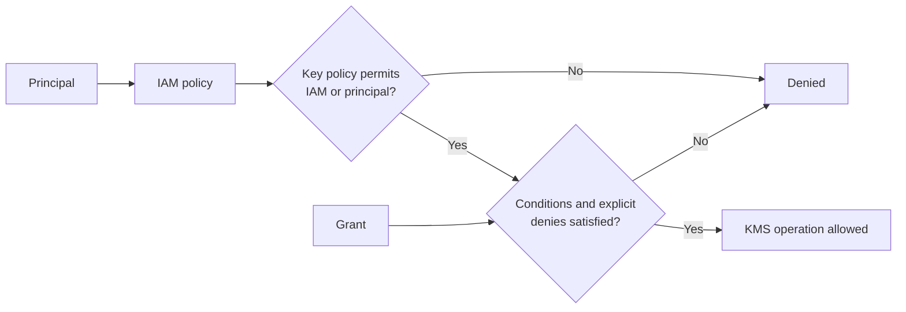
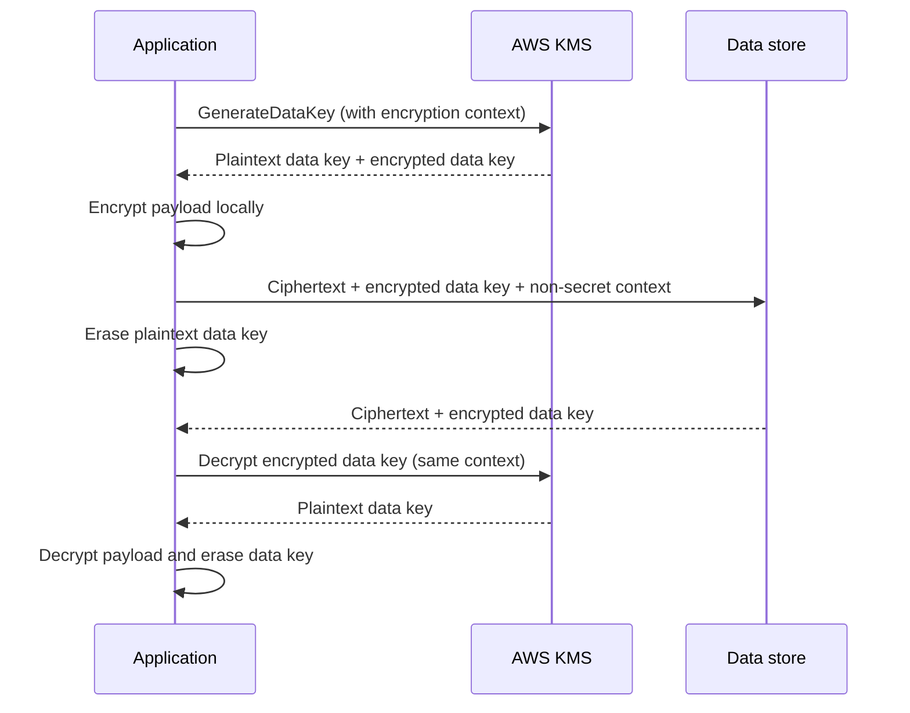

# AWS KMS Best Practices

AWS Key Management Service (AWS KMS) protects key material and performs cryptographic operations. A KMS key is not a general-purpose secret store: keep passwords, tokens, and similar values in AWS Secrets Manager or Systems Manager Parameter Store and use KMS to protect them.

## Choose the Right Key Type

Selecting the correct key type determines which cryptographic operations are available and prevents architectural mismatches later.

| Key type | Supported operations | Typical use |
|---|---|---|
| **Symmetric encryption** | Encrypt, decrypt, re-encrypt, and generate data keys | Default choice for envelope encryption and most AWS service integrations |
| **Asymmetric** | Encrypt/decrypt, sign/verify, or key agreement, depending on `KeyUsage` and `KeySpec` | Workloads that require a public key or signatures outside AWS KMS |
| **HMAC** | Generate and verify MACs | Message authenticity and integrity |

- Prefer AWS owned or AWS managed keys when you do not need to control policy, lifecycle, rotation, or cross-account access.
- Use a customer managed key when you need those controls, a distinct audit boundary, imported key material, a custom key store, or a multi-Region key.
- Treat multi-Region keys as interoperable copies of the same key material, not as backups. Each replica has its own key policy, grants, aliases, tags, and regional availability.
- Use aliases in application configuration so that manual key replacement does not require distributing a new key ARN. Use a key ARN when a policy or API specifically requires an unambiguous key identity.

### Key States

`Compromised` is not an AWS KMS key state. Investigate suspected compromise, stop new use, and replace the key according to the incident plan.

Recognizing key states early prevents failed operations and guides the correct remediation path.

| State | Meaning | Operational response |
|---|---|---|
| `Enabled` | Cryptographic operations are available | Normal operation |
| `Disabled` | Cryptographic operations fail | Re-enable only after confirming that use is intended |
| `PendingDeletion` | Key is in the configurable 7–30 day waiting period | Alarm on attempted use; cancel deletion if dependencies remain |
| `PendingImport` | Imported key material is absent or expired | Import valid key material before use |
| `Unavailable` | A custom key store is disconnected | Restore the custom key store and its dependencies |
| `Creating`, `Updating`, `PendingReplicaDeletion` | Transitional states for supported key types | Wait for the transition and monitor for failure |

## Authorization and Key Policies

Every KMS key has exactly one key policy. In the key-owning account, an IAM policy can grant access only when the key policy delegates permission management to the account; a key policy can also grant a principal directly. Explicit denies still win. For cross-account use, the key policy in the key-owning account **and** an IAM policy in the caller's account are required.

Proper authorization separates administrative power from routine use and keeps the blast radius of a compromised credential small.

| Control | Best practice |
|---|---|
| Key administrators | Use dedicated roles; do not give application roles administrative or deletion permissions |
| Key users | Grant only the required cryptographic operations and resources |
| Account principal | Understand that `arn:aws:iam::<account-id>:root` delegates authority to the account; it does not mean only the root user |
| Service access | Restrict with `kms:ViaService`, encryption-context conditions, and source-account/source-ARN conditions where supported |
| Deletion | Separate `kms:ScheduleKeyDeletion` and `kms:CancelKeyDeletion` from routine administration; require change control |
| Policy safety | Keep a recoverable administrator path and do not bypass the policy lockout safety check without a controlled reason |

### Common Application Permissions

Mapping permissions to encryption patterns avoids overprivileged roles and makes access reviews faster.

| Pattern | Common permissions |
|---|---|
| Encrypt a small payload directly | `kms:Encrypt`, often `kms:DescribeKey` |
| Decrypt existing ciphertext | `kms:Decrypt`, often `kms:DescribeKey` |
| Envelope encryption | `kms:GenerateDataKey` to encrypt; `kms:Decrypt` to recover the data key |
| Re-encrypt without exposing plaintext | `kms:ReEncryptFrom` on the source and `kms:ReEncryptTo` on the destination |
| Service integration | Service-specific permissions; some services create grants on the caller's behalf |

Avoid granting `kms:CreateGrant` broadly. When it is necessary, use `kms:GrantIsForAWSResource`, grant-operation conditions, and a specific grantee.

## Envelope Encryption

Use data keys for payloads larger than the KMS API plaintext limit and for high-throughput encryption. Store the encrypted data key with the ciphertext and erase the plaintext data key from memory as soon as practical.

- Bind ciphertext to its purpose with an encryption context. The context is authenticated but **not encrypted**, so never put secrets in it.
- Use the AWS Encryption SDK or an AWS service integration instead of designing a custom envelope format.
- Encryption context must match exactly for decrypt operations. Log and document the context schema.

## Rotation and Replacement

Choosing the right rotation strategy balances forward secrecy with operational complexity and decryptability of existing data.

| Method | Applies to | Behavior |
|---|---|---|
| Automatic rotation | Customer managed, symmetric encryption keys with `AWS_KMS` key material | Default period is 365 days; configurable from 90 through 2,560 days |
| On-demand rotation | Supported customer managed symmetric encryption keys with `AWS_KMS` or `EXTERNAL` origin | Rotates backing material without changing the key ID or re-encrypting existing ciphertext |
| Manual replacement | All key types | Create a new key, move aliases/configuration, and optionally re-encrypt data |

AWS managed keys rotate automatically every year and cannot be configured by customers. Automatic and on-demand rotation retain old backing material so existing ciphertext remains decryptable. Rotation does not mitigate compromised plaintext, excessively broad access, or leaked data keys; use manual replacement and re-encryption when the risk assessment requires a new key boundary.

## Grants

Grants are commonly used by integrated AWS services for temporary or delegated access. They are eventually consistent; use a grant token when the new grant must be used immediately.

Tight grant constraints limit what a principal can do with the key and for which data, reducing the impact of misuse.

| Control | Recommendation |
|---|---|
| Operations | Include only the operations the grantee requires |
| Grantee | Use a specific role or supported service principal |
| `EncryptionContextEquals` | Require an exact encryption context for supported symmetric operations |
| `EncryptionContextSubset` | Require named context pairs while allowing additional pairs |
| Source ARN constraint | Restrict use to requests made for a specific AWS resource when supported |
| Lifecycle | Retire temporary grants; reserve revoke for key administrators |

`RetiringPrincipal` and the grant ID identify/manage a grant; they are not grant constraints.

## Monitoring and Incident Readiness

Monitoring KMS activity surfaces policy changes, misuse, and infrastructure failures before they cause data loss or outages.

| Signal | What to monitor |
|---|---|
| CloudTrail | Key creation, policy changes, grants, enable/disable, rotation settings, imported material, and deletion scheduling/cancellation |
| KMS `SuccessfulRequest` metric | Successful cryptographic operations by key and operation; detect unexpected use and quota/cost growth |
| Imported material | `SecondsUntilKeyMaterialExpiration` and alarms well before expiry |
| Custom key stores | Throttling, proxy errors/latency, certificate expiry, credentials, and external key-manager health |
| Service Quotas | Request-rate utilization and throttling |

- Create high-severity alerts for `PutKeyPolicy`, `ScheduleKeyDeletion`, `DisableKey`, `DeleteImportedKeyMaterial`, and unexpected `CreateGrant` calls.
- Maintain an inventory of key owners, dependent services, aliases, policy purpose, rotation method, and recovery/runbook links.
- Before scheduling deletion, disable the key, monitor attempted use, inventory grants and aliases, and retain the full waiting period appropriate to the workload.
- Test encrypted-data recovery, including cross-account and multi-Region failure scenarios. A KMS key cannot be exported as a backup.

## Cost and Scale

KMS prices and free tiers vary by key type, operation, and Region. Use the current pricing page instead of embedding dollar amounts in architecture standards.

- Consolidate keys only when tenants, data classifications, administrators, retention, and blast-radius requirements permit it.
- Cache data keys only with a bounded age/use count and an approved cryptographic materials cache.
- Use `GenerateDataKeyWithoutPlaintext` when a component should provision encrypted data keys but must not receive plaintext key material.
- Review KMS request quotas before high-throughput launches and use envelope encryption to avoid a KMS call per data block.

## Authoritative References

- [AWS KMS concepts and key types](https://docs.aws.amazon.com/kms/latest/developerguide/concepts.html)
- [AWS KMS key states](https://docs.aws.amazon.com/kms/latest/developerguide/key-state.html)
- [AWS KMS key policies](https://docs.aws.amazon.com/kms/latest/developerguide/key-policies.html)
- [AWS KMS grants and constraints](https://docs.aws.amazon.com/kms/latest/developerguide/grants.html)
- [Rotating AWS KMS keys](https://docs.aws.amazon.com/kms/latest/developerguide/rotate-keys.html)
- [AWS KMS CloudWatch metrics](https://docs.aws.amazon.com/kms/latest/developerguide/monitoring-cloudwatch.html)
- [AWS KMS pricing](https://aws.amazon.com/kms/pricing/)
