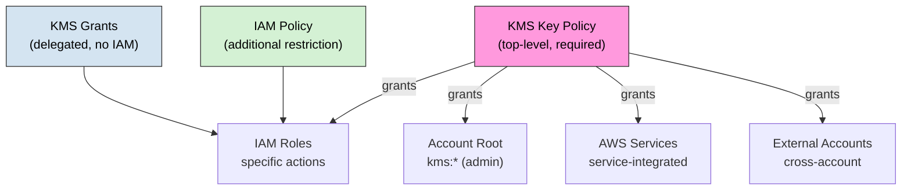
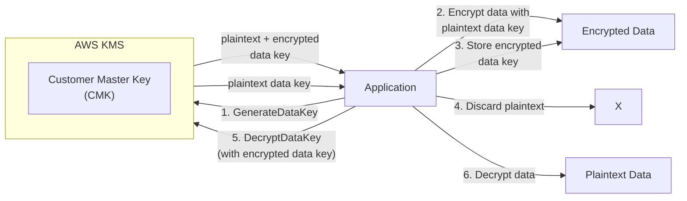

# KMS Best Practices

## Key Management

### Key Types

| Type | Description | Use Case |
|------|-------------|----------|
| **Symmetric** | Encrypt and decrypt | General encryption |
| **Asymmetric** | Sign/verify, encrypt/decrypt | Code signing, document signing |
| **HMAC** | MAC generation/verification | Data integrity |

### Key States

| State | Description | Action Required |
|-------|-------------|-----------------|
| **Enabled** | Key is operational | Normal operation |
| **Disabled** | Key is not operational | Re-enable when needed |
| **Pending Deletion** | Scheduled for deletion (7-30 days) | Cancel or wait |
| **Compromised** | Key is compromised | Rotate immediately |

### Key Metadata

| Attribute | Description | Best Practice |
|-----------|-------------|---------------|
| **Description** | Key purpose | Clear, descriptive |
| **Key Spec** | Key specification | SYMMETRIC_DEFAULT or specific |
| **Key Usage** | Encrypt/decrypt or sign/verify | Match use case |
| **Origin** | AWS KMS or external | AWS KMS for managed |
| **Key ID / ARN** | Unique identifier (CMK is legacy term) | Track in inventory |

---

## Key Policies

### Key Policy Structure

| Principal | Action | Effect | Use Case |
|-----------|--------|--------|----------|
| **AWS (account root)** | kms:* | Allow | Account administration |
| **IAM users/roles** | Specific actions | Allow | Application access |
| **AWS services** | Service-integrated actions | Allow | Service integration |
| **Other accounts** | Cross-account access | Allow/Deny | Cross-account encryption |

### Key Policy Best Practices

| Practice | Description |
|----------|-------------|
| **Administrative principal** | Designate specific IAM role, not root |
| **Least privilege** | Grant only required actions |
| **Multi-Region keys** | Enable for DR scenarios (no backup key feature) |
| **Rotation** | Enable automatic rotation (default annual; customizable 90 days-7 years) |
| **Policy validation** | Test before deployment |

### Common Key Actions

| Action | Description | Grant To |
|--------|-------------|----------|
| kms:CreateGrant | Create grants | Applications needing encryption |
| kms:Decrypt | Decrypt data | Applications reading data |
| kms:DescribeKey | View key metadata | Administrators, auditors |
| kms:Encrypt | Encrypt data | Applications writing data |
| kms:GenerateDataKey | Generate data keys | Applications using envelope encryption |
| kms:GenerateDataKeyWithoutPlaintext | Generate encrypted-only | Applications without plaintext need |
| kms:ListGrants | List grants | Administrators |
| kms:RetireGrant | Retire grants | Administrators |
| kms:RevokeGrant | Revoke grants | Administrators |

---

## Encryption Strategies

### Envelope Encryption

| Step | Action | Description |
|------|--------|-------------|
| 1 | Generate Data Key | KMS generates plaintext + encrypted data key |
| 2 | Encrypt data | Application uses plaintext data key |
| 3 | Store encrypted data key | With encrypted data |
| 4 | Discard plaintext | Remove from memory |
| 5 | Decrypt when needed | KMS decrypts stored data key |

### Encryption by Service

| Service | KMS Integration | Recommendation |
|---------|----------------|----------------|
| **EBS** | Volume encryption | Enable default encryption |
| **S3** | Server-side encryption | SSE-KMS for audit trail |
| **RDS** | DB encryption | KMS encryption at rest |
| **Redshift** | Cluster encryption | KMS encryption |
| **EFS** | File system encryption | KMS encryption |
| **SES** | Email encryption | KMS for stored emails |
| **SQS** | Queue encryption | KMS encryption |
| **SNS** | Topic encryption | KMS encryption |
| **Secrets Manager** | Secret encryption | AWS managed or custom KMS |
| **CloudTrail** | Trail encryption | KMS encryption |
| **Backup** | Vault encryption | KMS encryption |

---

## Key Rotation

### Rotation Options

| Method | Frequency | Description |
|--------|-----------|-------------|
| **Automatic** | Annual by default; configurable rotation period from 90 days to 2,560 days (7 years) | Enable rotation, optionally set a custom period |
| **Manual** | As needed | Create new key, migrate |
| **On-demand** | Immediate | Rotate key material outside the automatic schedule, independent of automatic rotation setting |

### Rotation Best Practices

| Practice | Description |
|----------|-------------|
| **Enable automatic rotation** | For all customer-managed keys |
| **Test after rotation** | Verify decryption works |
| **Monitor rotation** | CloudWatch events for rotation |
| **Document rotation** | Track rotation history |
| **Plan for migration** | Manual rotation (creating a new key) requires re-encrypting data; automatic/on-demand rotation of a key's backing material does not require re-encryption |

---

## Grants

### Grant Usage

| Feature | Description | Use Case |
|---------|-------------|----------|
| **Grants** | Delegate KMS access without IAM | Cross-account, service integration |
| **Constraints** | Limit grant operations | Encryption-only grants |
| **Retirement** | Auto-retire after use | One-time operations |
| **Tokens** | Secure grant reference | Grant identification |

### Grant Constraints

| Constraint | Description | Use Case |
|------------|-------------|----------|
| **EncryptionContextKeys** | Required encryption context keys | Context validation |
| **EncryptionContextSubset** | Specific encryption context | Context restriction |
| **EncryptionContextSuperset** | Minimum encryption context | Context flexibility |
| **RecipientPrincipal** | Principal that can decrypt | Access delegation |
| **RetiringPrincipal** | Principal that can retire | Grant management |

---

## Monitoring

### CloudTrail Events

| Event | Description | Alert |
|-------|-------------|-------|
| CreateKey | New key created | Verify authorization |
| ScheduleKeyDeletion | Key deletion scheduled | Verify authorization |
| CancelKeyDeletion | Deletion cancelled | Informational |
| DisableKey | Key disabled | Verify authorization |
| EnableKey | Key enabled | Informational |
| UpdateKeyPolicy | Policy changed | Verify authorization |
| RotateKey | Key rotated | Informational |
| Encrypt/Decrypt | Encryption operations | Anomaly detection |

### CloudWatch Metrics

| Metric | Description | Alert |
|--------|-------------|-------|
| EncryptionOperations | Encrypt calls | Anomaly detection |
| DecryptionOperations | Decrypt calls | Anomaly detection |
| GenerateDataKeyOperations | Data key generation | Anomaly detection |
| InvalidSignatureErrors | Signature errors | Security alert |
| KeyUsageMetrics | Key utilization | Capacity planning |

---

## Cost Optimization

| Strategy | Description | Potential Savings |
|----------|-------------|-------------------|
| **Consolidate keys** | Fewer keys for similar purposes | Per-key cost ($1/month) |
| **AWS-managed keys** | Free for AWS service encryption | Eliminate key costs |
| **Right-size usage** | Use KMS only where needed | API call costs |
| **Multi-Region replication** | Only for DR requirements | Per-region key cost |
| **Cleanup unused keys** | Schedule deletion for unused keys | Eliminate waste |

### Pricing

| Component | Price |
|-----------|-------|
| **Customer-managed key** | $1.00/key/month |
| **Encrypt/Decrypt** | $0.03 per 10,000 calls |
| **GenerateDataKey** | $0.03 per 10,000 calls |
| **Sign/Verify** | $0.05 per 10,000 calls |
| **Multi-Region replication** | $1.00/key/month per region |
| **AWS-managed keys** | Free |

---

## Cross-Service Integration

| Service | Integration | Purpose |
|---------|------------|---------|
| CloudTrail | API activity logging | Audit trail |
| CloudWatch | Metrics, alarms | Monitoring |
| Config | Key compliance | Governance |
| Organizations | Multi-account key management | Enterprise |
| Backup | Encrypted backups | Data protection |
| Secrets Manager | Secret encryption | Credential security |
| SSM Parameter Store | Parameter encryption | Configuration security |
