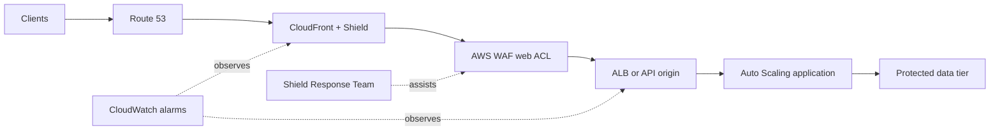
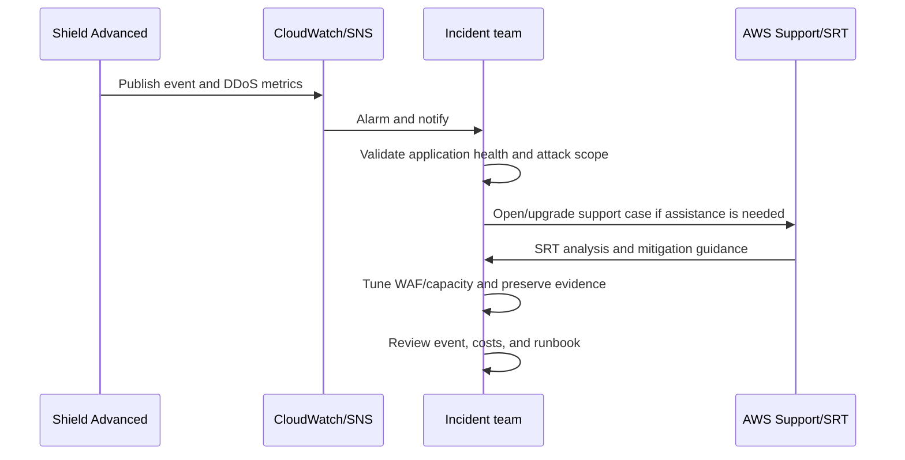

# AWS Shield Best Practices

AWS Shield protects AWS-hosted applications from distributed denial-of-service (DDoS) attacks. Shield does not replace AWS WAF, resilient architecture, capacity planning, or an incident-response process.

## Shield Standard and Shield Advanced

Understanding the capability gap between the free tier and the paid tier prevents over-provisioning and ensures cost protection is available where it matters.

| Capability | Shield Standard | Shield Advanced |
|---|---|---|
| Enrollment | Included automatically with AWS accounts | Paid subscription with a commitment; enroll and protect resources explicitly |
| Core protection | Automatic network and transport-layer DDoS detection and inline mitigation for supported AWS services | Enhanced detection and mitigation, visibility, health-based detection, and protected-resource controls |
| Application layer | Use AWS WAF separately | AWS WAF is central to layer 7 protection; automatic application-layer DDoS mitigation is available for eligible CloudFront and ALB protections |
| Visibility | Service-level protections with limited customer event detail | DDoS event diagnostics, CloudWatch metrics, dashboards, and notifications |
| Response support | Normal AWS Support path | Shield Response Team (SRT) assistance when support-plan prerequisites are met |
| Cost protection | Not included | DDoS cost protection for eligible scaling charges, subject to prerequisites and credit approval |
| Organization management | Not applicable | AWS Firewall Manager can apply policy centrally to supported resource types |

Do not describe Shield Advanced as protecting against every attack. It focuses on DDoS; injection, credential abuse, authorization flaws, malware, and data exposure require other controls.

### When Shield Advanced Is a Good Fit

- Internet-facing workloads where availability has a material business or safety impact.
- Applications with a high likelihood or history of DDoS targeting.
- Organizations that need SRT engagement, detailed DDoS visibility, or DDoS cost protection.
- Multi-account estates that need centrally governed protection through AWS Firewall Manager.

Evaluate the current subscription, support-plan, WAF, and cost-protection requirements before purchasing. “Public-facing” alone does not make Shield Advanced mandatory.

## Supported Resources and Scope

Shield Standard protections apply automatically to supported AWS edge and regional entry points. Shield Advanced can create explicit protections for the following resource types documented by AWS:

Mapping each entry point to the correct protection model ensures no internet-facing asset is left outside the DDoS defense perimeter.

| Resource | Shield Advanced guidance |
|---|---|
| CloudFront distribution | Preferred public HTTP(S) entry point; associate AWS WAF and consider automatic application-layer DDoS mitigation |
| Route 53 hosted zone | Protect authoritative DNS and monitor DNS-query health |
| Global Accelerator standard accelerator | Use for static anycast entry points and origin shielding for supported endpoints |
| Elastic IP address | Protect the EIP and the resource exposed through it |
| Application Load Balancer | Protect the ALB; associate a regional web ACL for layer 7 controls |
| Classic Load Balancer | Explicitly protect when still required; prefer modern load balancers for new designs |
| Network Load Balancer | Protect through its associated Elastic IP addresses; AWS WAF does not associate with NLBs |

A VPC, EC2 instance without an eligible entry-point resource, web ACL, or API Gateway API is not itself a Shield Advanced protected-resource type. API Gateway can be protected at layer 7 with AWS WAF (REST APIs) or placed behind CloudFront where appropriate.

Shield Advanced resource protection supports IPv4, not IPv6. If the application accepts IPv6, document the exposure and verify the current service behavior and compensating edge architecture.

## Layered DDoS-Resilient Architecture

A defense-in-depth approach distributes DDoS controls across every network hop so no single layer becomes the failure point.

| Layer | Controls |
|---|---|
| Edge and DNS | Route 53, CloudFront, Global Accelerator, anycast ingress, and Shield |
| Network/transport | Shield mitigation, NLB/ALB, security groups, and minimal exposed ports |
| Application | AWS WAF managed/custom rules, rate-based rules, CAPTCHA/Challenge, caching, and origin protection |
| Capacity and health | Auto Scaling, resilient multi-AZ origins, dependency limits, Route 53 health checks, and load shedding |
| Operations | Metrics, alarms, SNS notifications, runbooks, AWS Support/SRT access, and game days |

- Hide and restrict origins. For CloudFront origins, allow only CloudFront-originated traffic using supported managed prefix lists, secret headers where appropriate, or service-specific origin access controls.
- Cache safe content at CloudFront to absorb request volume before it reaches the origin.
- Set WAF rate limits from measured legitimate traffic and test rules in Count mode before enforcing them.
- Protect dependencies from a successful traffic surge using queues, concurrency controls, circuit breakers, and admission control.
- Avoid relying on network ACLs as a dynamic DDoS control; they are stateless, coarse, and operationally difficult to change during an event.

## Shield Advanced Setup

Following a structured setup sequence prevents gaps between subscription activation and actual resource protection.

| Step | Best practice |
|---|---|
| Subscription ownership | Use a designated security account and document the payer/commitment model |
| Protection coverage | Inventory every eligible internet-facing entry point and automate association for new resources |
| Protection groups | Group resources that share a workload so events and health can be evaluated coherently |
| Health checks | Associate meaningful Route 53 health checks where supported; health-based detection depends on accurate signals |
| Application-layer mitigation | For eligible CloudFront/ALB protections, enable automatic mitigation only after the associated web ACL and baseline are ready |
| SRT access | Proactively authorize the SRT to inspect and update WAF protections; confirm required AWS Support plan |
| Notifications | Configure Shield Advanced SNS event notifications and CloudWatch alarms |
| Organization rollout | Use Firewall Manager for supported resources; manage Route 53 and Global Accelerator protections separately because Firewall Manager Shield policies do not support them |

## Detection, Response, and Testing

Before an event:

- Record resource ARNs, application owners, support contacts, escalation severity, and the AWS Support case procedure.
- Confirm SRT authorization rather than waiting for an incident.
- Run controlled game days. Do **not** generate DDoS traffic or use a load-testing vendor without following AWS's DDoS simulation testing policy and obtaining any required approval.
- Test alarms against application health degradation as well as traffic volume.

During an event, Shield mitigation is automatic. Contact AWS Support when application health is affected, mitigation needs tuning, the event is not visible, or you require SRT assistance. Preserve timestamps, resource ARNs, health symptoms, request samples, and WAF logs.

## Monitoring

Shield Advanced publishes metrics in `AWS/DDoSProtection`. Global-service and protection-group metrics are reported in `us-east-1`; regional-resource metrics are reported in the resource's Region.

Aligning the right metric to the right alarm turns raw DDoS telemetry into actionable incident signals.

| Metric | Use |
|---|---|
| `DDoSDetected` | Alarm when nonzero, then correlate with health and traffic; nonzero does not by itself prove customer impact |
| `DDoSAttackBitsPerSecond` | Network/transport event volume in bits per second |
| `DDoSAttackPacketsPerSecond` | Network/transport event packet rate |
| `DDoSAttackRequestsPerSecond` | Application-layer request-flood rate when available |
| `VolumePacketsPerSecond` / `VolumeBitsPerSecond` | Mitigation and top-contributor visibility with the documented dimensions |

Also monitor ALB/CloudFront/Route 53 health, origin latency/error rates, WAF `AllowedRequests`, `BlockedRequests`, `CountedRequests`, and dependency saturation. Shield metrics are more frequent during an event and otherwise can be reported only periodically, so they should not be the sole application-health signal.

## Cost Protection and Pricing

Shield Advanced pricing, data-transfer inclusions, and DDoS cost-protection eligibility can change and differ by resource or agreement. Use the current pricing and cost-protection pages instead of embedding packet, bandwidth, or regional prices.

To remain eligible for DDoS cost protection, follow the documented architecture and operational prerequisites, including appropriate Shield Advanced protection, WAF protection for application-layer resources, and timely SRT engagement where required. Cost protection is a credit process, not automatic reimbursement for every charge.

## Authoritative References

- [AWS Shield features](https://docs.aws.amazon.com/waf/latest/developerguide/shield-chapter.html)
- [Resources supported by Shield Advanced](https://docs.aws.amazon.com/waf/latest/developerguide/ddos-resource-protections.html)
- [Shield Advanced metrics](https://docs.aws.amazon.com/waf/latest/developerguide/shield-metrics.html)
- [Shield Response Team support](https://docs.aws.amazon.com/waf/latest/developerguide/authorize-srt.html)
- [Automatic application-layer DDoS mitigation](https://docs.aws.amazon.com/waf/latest/developerguide/ddos-automatic-app-layer-response.html)
- [AWS best practices for DDoS resiliency](https://docs.aws.amazon.com/whitepapers/latest/aws-best-practices-ddos-resiliency/welcome.html)
- [AWS DDoS simulation testing policy](https://aws.amazon.com/security/ddos-simulation-testing/)
- [AWS Shield pricing](https://aws.amazon.com/shield/pricing/)
