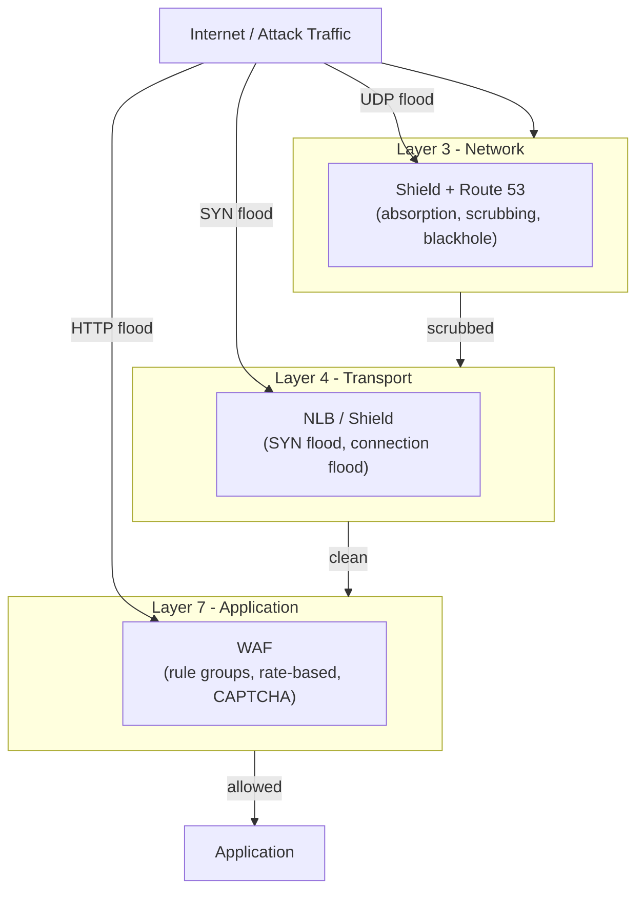
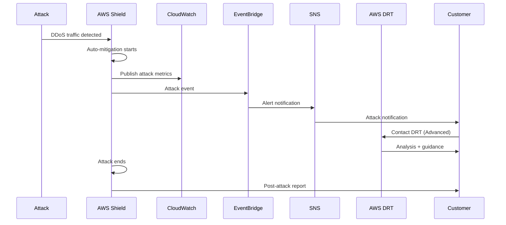

# Shield Best Practices

## Shield vs Shield Advanced

### Feature Comparison

| Feature | Shield Standard | Shield Advanced |
|---------|----------------|-----------------|
| **Availability** | Automatic, included | Automatic, subscription |
| **DDoS Protection** | Common volumetric | All attack types |
| **WAF Integration** | Basic | Advanced rules |
| **AWS Response Team** | No | 24/7 DRT access |
| **Attack Insights** | Basic | Detailed analytics |
| **Cost Protection** | No | Abuse cost reimbursement |
| **Event Response** | Automated | Human + automated |
| **Health Dashboard** | No | Yes |
| **Price** | Free | $3,000/month + usage |

### When to Use Shield Advanced

| Criteria | Recommendation |
|----------|---------------|
| Public-facing applications | **Recommended** |
| Revenue-critical workloads | **Recommended** |
| High-profile targets | **Required** |
| Compliance requirements | **Recommended** |
| Internal-only applications | Not needed |
| Low-risk workloads | Shield Standard sufficient |

---

## Protection Strategies

### Layered Defense

| Layer | Service | Purpose |
|-------|---------|---------|
| **Network (L3/L4)** | Shield, Route 53 | Volumetric attacks |
| **Transport (L4)** | Shield, NLB | Protocol attacks |
| **Application (L7)** | WAF, Shield Advanced | Application attacks |
| **Identity** | IAM, Cognito | Credential attacks |
| **Data** | KMS, Macie | Data protection |

### Attack Types and Mitigation

| Attack Type | Layer | Mitigation | Service |
|-------------|-------|-----------|---------|
| **UDP Flood** | Network | Absorption, scrubbing | Shield |
| **SYN Flood** | Transport | SYN cookies, absorption | Shield |
| **HTTP Flood** | Application | Rate limiting, CAPTCHA | WAF + Shield |
| **Slowloris** | Application | Connection limits | WAF |
| **DNS Amplification** | Network | Response rate limiting | Shield |
| **NTP Amplification** | Network | Scrubbing | Shield |
| **Reflection Attacks** | Network | Scrubbing, blackhole | Shield |
| **CC Attacks** | Application | Rate-based rules | WAF |

---

## Resource Association

### Protectable Resources

| Resource | Shield Standard | Shield Advanced |
|----------|----------------|-----------------|
| **CloudFront distributions** | Yes | Yes |
| **Elastic IPs** | Yes | Yes |
| **ALB** | Yes | Yes |
| **NLB** | Yes | Yes |
| **Global Accelerator** | Yes | Yes |
| **VPC** | No | Yes (VPC-level protection via Shield Advanced) |
| **AWS WAF** | Yes | Yes |
| **Route 53** | Yes | Yes |

### Association Best Practices

| Practice | Description |
|----------|-------------|
| **Protect all public resources** | Associate all internet-facing resources |
| **New resource automation** | Auto-associate via CloudFormation/CDK |
| **Regular audit** | Check for unprotected resources |
| **Tag protected resources** | Track Shield coverage |
| **Document protection scope** | Know what is protected |

---

## Attack Response

### Response Workflow

| Phase | Action | Responsible |
|-------|--------|-------------|
| **Detection** | Automated detection by AWS | AWS Shield |
| **Notification** | SNS, EventBridge alerts | Shield Advanced |
| **Mitigation** | Automated traffic scrubbing | AWS Shield |
| **Communication** | DRT contact for Advanced | AWS DRT |
| **Analysis** | Post-attack review | AWS + Customer |
| **Hardening** | Apply lessons learned | Customer |

### DRT (Detection and Response Team)

| Feature | Description |
|---------|-------------|
| **24/7 availability** | Always-on support |
| **Technical expertise** | DDoS specialists |
| **Direct contact** | Dedicated phone/chat |
| **Attack analysis** | Detailed post-attack reports |
| **Mitigation guidance** | Custom recommendations |
| **Cost protection** | Abuse cost reimbursement |

---

## Monitoring

### Shield Metrics

| Metric | Description | Alert |
|--------|-------------|-------|
| AbsoluteBytes | Total traffic volume | Spike detection |
| AbsolutePackets | Total packet count | Spike detection |
| AttackBytes | Attack traffic volume | Attack detection |
| AttackPackets | Attack packet count | Attack detection |
| AttackVectors | Number of attack vectors | Attack complexity |
| MitigatedBytes | Mitigated traffic | Mitigation effectiveness |
| MitigatedPackets | Mitigated packets | Mitigation effectiveness |

### Event Monitoring

| Event | Description | Action |
|-------|-------------|--------|
| Attack started | New attack detected | Monitor, contact DRT |
| Attack mitigated | Attack being mitigated | Verify mitigation |
| Attack ended | Attack concluded | Post-attack review |
| Resource associated | New resource protected | Verify configuration |
| Resource disassociated | Resource unprotected | Investigate |

### CloudWatch Integration

| Integration | Description |
|-------------|-------------|
| **Shield metrics** | Published to CloudWatch |
| **Custom alarms** | Attack detection alarms |
| **Dashboards** | Security monitoring dashboards |
| **Logs** | Attack event logging |
| **Events** | EventBridge attack events |

---

## Cost Considerations

### Shield Advanced Pricing

| Component | Price |
|-----------|-------|
| **Monthly subscription** | $3,000/month minimum + $0.034/GB beyond allowance |
| **Usage beyond allowance** | $0.034/GB (network), $0.000015/packet |
| **Included allowance** | 1 TB/second, 5 M pps (varies by resource type) |
| **Cost protection** | Reimbursement for abuse costs |
| **Multi-region** | Per-region pricing |

### Cost Optimization

| Strategy | Description |
|----------|-------------|
| **Right-size protection** | Only protect internet-facing resources |
| **Cost protection benefit** | Abuse cost reimbursement |
| **WAF integration** | Reduce L7 attack impact |
| **Architecture hardening** | Reduce attack surface |
| **Regular review** | Optimize protected resources |

### Cost-Benefit Analysis

| Factor | Consideration |
|--------|---------------|
| **Revenue impact** | Downtime cost vs Shield cost |
| **Reputation risk** | Brand damage from attacks |
| **Compliance** | Regulatory requirements |
| **Attack likelihood** | Industry targeting risk |
| **Cost protection** | Potential abuse cost savings |

---

## Architecture Recommendations

### Recommended Architecture

| Component | Configuration |
|-----------|---------------|
| **CloudFront** | Shield Advanced + WAF |
| **WAF** | Managed rules + rate-based |
| **Route 53** | Health checks + failover |
| **ALB/NLB** | Shield Advanced association |
| **Global Accelerator** | Shield Advanced association |
| **VPC** | Shield Advanced VPC protection |
| **Security groups** | Least privilege rules |
| **NACLs** | Explicit deny rules |

### Multi-Region Protection

| Setting | Recommendation |
|---------|---------------|
| **Enable in all regions** | Where resources exist |
| **Centralized management** | Organization-level |
| **Cross-region monitoring** | Centralized CloudWatch |
| **DR plan** | Include DDoS scenarios |
| **Testing** | Regular DR drills |

---

## Cross-Service Integration

| Service | Integration | Purpose |
|---------|------------|---------|
| WAF | Application-layer protection | L7 attack mitigation |
| CloudFront | Edge protection | Global DDoS mitigation |
| Route 53 | DNS protection | DNS attack mitigation |
| CloudWatch | Metrics, alarms | Monitoring |
| EventBridge | Attack events | Automation |
| SNS | Notifications | Alerting |
| Config | Compliance rules | Governance |
| GuardDuty | Threat detection | Security findings |
| Security Hub | Centralized findings | Compliance |
