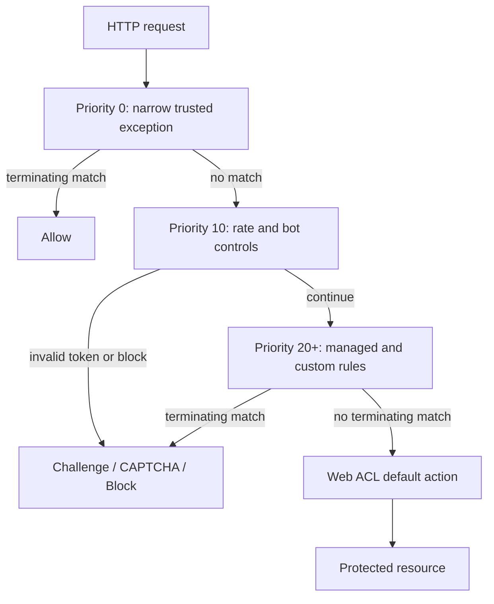

# AWS WAF Best Practices

AWS WAF inspects HTTP(S) requests sent to supported resources. It complements, but does not replace, secure application code, authentication, authorization, DDoS protection, and dependency-level rate controls.

## Scope and Associations

Understanding scope and association targets prevents misconfigured web ACLs that silently fail to protect the intended resource.

| Web ACL scope | Supported association examples |
|---|---|
| `CLOUDFRONT` (global) | CloudFront distributions; create and manage the web ACL in `us-east-1` |
| `REGIONAL` | Application Load Balancer, API Gateway **REST API**, AppSync GraphQL API, Cognito user pool, App Runner service, Verified Access instance, Amplify application, and other resource types listed in the current AWS WAF documentation |

AWS WAF does not associate directly with Network Load Balancers, Global Accelerator, API Gateway HTTP APIs/WebSocket APIs, or arbitrary EC2 instances. Put a supported HTTP entry point in front of those workloads when WAF inspection is required.

## Rule Evaluation and Actions

Rules run in ascending numeric priority. A terminating action ends evaluation; non-terminating actions can add labels that later rules match.

Choosing the right action determines whether traffic is silently observed, actively blocked, or sent through a human verification step.

| Action | Terminating behavior | Use |
|---|---|---|
| `Allow` | Terminates | Explicit, narrow allow rules; avoid broad bypasses |
| `Block` | Terminates | Reject known unwanted requests, optionally with a custom response |
| `Count` | Continues | Test and observe a rule without enforcement |
| `CAPTCHA` | Terminates when the token is absent/invalid; continues with a valid token | Human interaction for suspicious browser traffic |
| `Challenge` | Terminates when the token is absent/invalid; continues with a valid token | Silent browser challenge for suspicious automated traffic |

- Keep allowlist exceptions narrow and place them only after deciding which controls they are allowed to bypass.
- Use labels to separate detection from enforcement and to combine managed-rule results with application context.
- Give every rule and web ACL a unique CloudWatch metric name and enable visibility configuration.

## Baseline Protection

Start with threats demonstrated by the application and threat model, not every rule group at once.

Layered controls address different threat categories, so selecting the right combination balances security coverage against cost and false-positive risk.

| Control | Guidance |
|---|---|
| AWS Managed Rules baseline | Evaluate Common Rule Set, Known Bad Inputs, Amazon IP Reputation, and Anonymous IP List as relevant |
| Platform-specific groups | Add Linux, Unix, Windows, PHP, or WordPress groups only for technology actually exposed |
| Injection protection | Evaluate SQL database and application-specific injection rules; tune body-size and encoding behavior |
| Admin paths | Restrict administrative endpoints by identity/network and consider Admin Protection rules |
| Account abuse | Evaluate Account Takeover Prevention (ATP) for login pages and Account Creation Fraud Prevention (ACFP) for registration pages |
| Bots | Use Bot Control when category, signal, or targeted bot protection justifies its additional request charges |

AWS Managed Rules can change. Subscribe to update notifications, pin versions where the group supports versioning, review expiry notifications, and test a new version before promotion. “Free” managed groups can still incur normal web ACL, rule, request, logging, and capacity-related charges; intelligent threat mitigation groups have additional request fees.

### Safe Rollout

1. Define success metrics and expected legitimate traffic.
2. Deploy new managed groups with rule-action overrides to `Count` where supported.
3. Inspect sampled requests and full logs, then add the narrowest exclusions or scope-down statements.
4. Promote rules to `Block`, `Challenge`, or `CAPTCHA` in stages.
5. Watch business KPIs and WAF metrics after every change; retain an immediate rollback path.

Do not exclude an entire managed rule group because of one false positive. Override or scope down the specific inner rule and document the risk accepted.

## Rate-Based Rules

A rate-based rule tracks request aggregates over a configurable evaluation window and applies its action when an aggregate exceeds the configured limit. It is not an exact request quota and detection can lag traffic changes.

Properly tuned rate-based rules distinguish legitimate burst traffic from abuse without degrading the experience for real users.

| Setting | Recommendation |
|---|---|
| Aggregation | Use source IP/forwarded IP for simple clients; use custom keys such as headers, cookies, URI path, labels, or combinations when identity is not represented by IP |
| Forwarded IP | Trust the forwarding header only when an upstream proxy controls it; define fallback behavior for malformed/missing values |
| Constant aggregation | Pair with a scope-down statement to rate-limit all requests in a selected population |
| Evaluation window | Choose based on burst tolerance and desired response speed |
| Limit | Derive from p95/p99 legitimate behavior, load tests, and backend capacity—not a generic number |
| Exceptions | Separate verified health checks, trusted automation, and known bots with narrow conditions |
| Deployment | Start with `Count`; use managed keys or custom keys that attackers cannot cheaply rotate |

Use application-identity quotas in API Gateway, Cognito, or the application when the requirement is a strict per-customer quota. WAF rate-based rules are primarily a protective control.

## Request Inspection Limits

AWS WAF inspects only the configured portion of request bodies and other components. Oversize handling can allow, block, or continue inspection depending on the statement and configuration.

- Know the body inspection limit for each associated resource type and any configured body-size increase.
- Set oversize handling deliberately, especially for upload and API endpoints.
- Normalize and constrain request formats in the application; WAF transformations are not a substitute for server-side validation.
- Monitor `SizeRestrictions_*` managed-rule labels/matches before creating exclusions.
- Budget web ACL capacity units (WCUs). Validate capacity before deployment and request quota increases only after simplifying duplicated logic.

## CAPTCHA, Challenge, and Token Handling

- These actions are intended for clients that can run the AWS WAF JavaScript integration or complete an interstitial challenge. API, machine-to-machine, accessibility, and non-browser clients need a compatible path.
- Configure immunity times according to risk. Longer immunity reduces repeated challenges but increases the value of a stolen token.
- Configure token domains only for domains that legitimately share tokens.
- Prefer `Challenge` for low-friction signals and `CAPTCHA` when stronger human interaction is warranted.
- Do not assume a valid token authenticates a user; it only represents successful WAF challenge handling.

## Logging and Data Protection

AWS WAF can send full logs to Amazon CloudWatch Logs, Amazon S3, or Amazon Data Firehose. Destination naming and permissions must follow the WAF logging requirements.

Logging provides forensic visibility into blocked and allowed traffic, but without proper controls it can expose sensitive data and incur significant storage costs.

| Control | Best practice |
|---|---|
| Full logging | Enable for production web ACLs, subject to data-classification and cost requirements |
| Logging filters | Keep blocked/challenged traffic and security-relevant labels; sample or drop routine allowed traffic when justified |
| Redaction | Redact authorization, cookies, query fields, or other sensitive components before delivery |
| Data protection | Use WAF data-protection settings where applicable and restrict access to logs and sampled requests |
| Retention | Set explicit retention/lifecycle and deletion controls on the destination |
| Encryption | Use destination encryption and tightly scoped KMS/key policies if customer managed keys are required |

Redacting fields in WAF logs does not redact the same fields from request sampling. Control access to sampled requests separately. Avoid logging secrets in URIs because they can also appear in origin and CDN logs.

### Metrics and Alarms

Use `AWS/WAFV2` metrics such as `AllowedRequests`, `BlockedRequests`, `CountedRequests`, `CaptchaRequests`, `ChallengeRequests`, and rule/label metrics. Alarm on ratios and changes from baseline rather than universal percentages. Correlate with origin 4xx/5xx errors, latency, authentication failures, conversions, and Shield events.

## Organization and Operations

- Manage common policies across accounts with AWS Firewall Manager while allowing documented application-specific exceptions.
- Define web ACLs, IP sets, regex pattern sets, logging, and alarms as infrastructure as code.
- Separate deployment roles from security approval where risk requires it.
- Review sampled requests, managed-rule changes, expiring versions, WCU utilization, logging health, and stale IP sets on a schedule.
- Use Firewall Manager compliance findings or AWS Config where supported to find unprotected resources.
- Keep break-glass procedures for an accidental block, including a tested way to update the web ACL without depending on the affected application.

## Cost Management

AWS WAF charges depend on web ACLs, rules/rule groups, inspected requests, request body size, CAPTCHA/Challenge use, intelligent threat mitigation, and logging destinations. Prices vary by Region and feature.

- Use scope-down statements to avoid sending irrelevant requests into paid managed rule groups.
- Use logging filters and destination lifecycle policies to control analytics cost without losing security-relevant records.
- Consolidate web ACLs only when applications can share ownership, policy, change cadence, and blast radius.
- Rule priority generally affects behavior, not the base number of configured-rule charges; do not claim that reordering rules alone reduces WAF price.

## Authoritative References

- [AWS WAF supported resources](https://docs.aws.amazon.com/waf/latest/developerguide/waf-chapter.html)
- [How AWS WAF rules and actions work](https://docs.aws.amazon.com/waf/latest/developerguide/web-acl-rule-actions.html)
- [Testing and tuning AWS WAF protections](https://docs.aws.amazon.com/waf/latest/developerguide/web-acl-testing.html)
- [Rate-based rule statements](https://docs.aws.amazon.com/waf/latest/developerguide/waf-rule-statement-type-rate-based.html)
- [Oversize request components](https://docs.aws.amazon.com/waf/latest/developerguide/waf-oversize-request-components.html)
- [AWS WAF logging destinations](https://docs.aws.amazon.com/waf/latest/developerguide/logging-destinations.html)
- [AWS WAF metrics](https://docs.aws.amazon.com/waf/latest/developerguide/waf-metrics.html)
- [AWS WAF pricing](https://aws.amazon.com/waf/pricing/)
