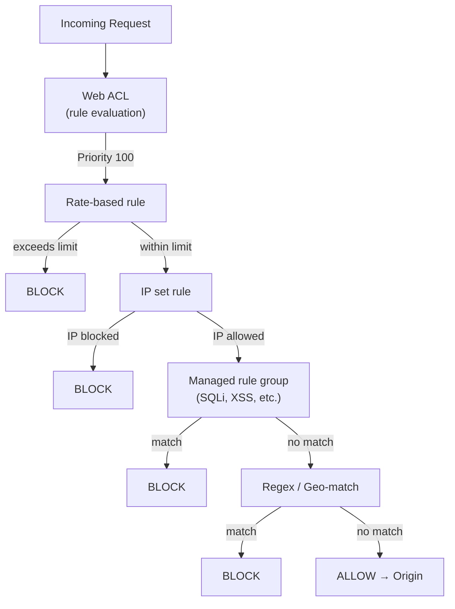
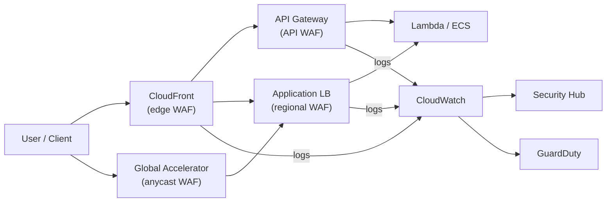

# WAF Best Practices

## Web ACL Configuration

### Rule Types

| Type | Description | Use Case |
|------|-------------|----------|
| **IP set** | Allow/block IP addresses | Known bad actors, geo-blocking |
| **Rate-based** | Throttle by request rate | DDoS, brute force |
| **Regex pattern** | Match URL patterns | Custom attack patterns |
| **SQL injection** | Detect SQL injection | OWASP Top 10 |
| **XSS** | Detect cross-site scripting | OWASP Top 10 |
| **Geo-match** | Allow/block by country | Geographic restrictions |
| **Label match** | Match rule labels | Complex rule logic |
| **Managed rule** | AWS/Partner managed rules | Pre-built protection |

### Rule Actions

| Action | Description | Use Case |
|--------|-------------|----------|
| **ALLOW** | Permit the request | Trusted traffic |
| **BLOCK** | Deny the request | Attack traffic |
| **COUNT** | Count without acting | Monitoring, testing |
| **CAPTCHA** | Challenge the requester | Bot mitigation |
| **Challenge** | JavaScript challenge | Bot detection |

---

## Managed Rule Groups

### AWS Managed Rules

| Rule Group | Description | Cost |
|------------|-------------|------|
| **AWSManagedRulesCommonRuleSet** | SQLi, XSS, common attacks | Free |
| **AWSManagedRulesAmazonIpReputationList** | AWS reputation data | Free |
| **AWSManagedRulesLinuxRuleSet** | Linux exploit protection | Free |
| **AWSManagedRulesSQLiRuleSet** | SQL injection protection | Free |
| **AWSManagedRulesUnixRuleSet** | Unix exploit protection | Free |
| **AWSManagedRulesWindowsRuleSet** | Windows exploit protection | Free |
| **AWSManagedRulesAdminProtection** | Admin path protection | Free |
| **AWSManagedRulesAPIProtocol** | API protocol compliance | Free |
| **AWSManagedRulesBotControlRuleSet** | Bot detection and control | Paid |
| **AWSManagedRulesWordPressRuleSet** | WordPress protection | Paid |

### Recommendation

| Environment | Recommended Rules |
|-------------|------------------|
| **Production (web)** | CommonRuleSet + SQLi + XSS + AdminProtection |
| **Production (API)** | CommonRuleSet + APIProtocol + Rate-based |
| **E-commerce** | CommonRuleSet + BotControl + Geo-match |
| **Internal app** | IP allowlist + Rate-based |
| **Public-facing** | All free rules + Rate-based |

---

## Rate-Based Rules

### Configuration

| Setting | Recommendation | Reason |
|---------|---------------|--------|
| **Limit** | Based on expected traffic | Prevent false positives |
| **Aggregate key** | IP, ACL, or forwarded IP | Granularity |
| **Scope down** | Specific paths or headers | Targeted throttling |
| **Action** | Count first, then block | Safe deployment |
| **Exclusion** | Trusted IPs, health checks | Avoid blocking legitimate traffic |

### Rate Calculation

| Factor | Consideration |
|--------|---------------|
| **Baseline traffic** | Normal request rate per IP |
| **Peak traffic** | Expected maximum rate |
| **Bot traffic** | Legitimate bots (search engines) |
| **CDN effect** | CloudFront origin vs edge |
| **API patterns** | Expected API call patterns |

---

## Bot Control

### Bot Categories

| Category | Action | Description |
|----------|--------|-------------|
| **Known bots** | Allow | Search engines, monitoring |
| **Verified bots** | Allow | Verified good bots |
| **Likely bots** | Challenge | Suspected bots |
| **Custom bots** | Configure | Application-specific |
| **Bad bots** | Block | Known malicious bots |

### CAPTCHA Configuration

| Setting | Recommendation |
|---------|---------------|
| **Insertion mode** | INLINE or REDIRECT | User experience |
| **Region restriction** | Match user regions | Availability |
| **Exclusion** | Trusted IPs, known bots | False positive reduction |
| **Response** | Custom blocked page | User experience |

---

## Logging

### Log Configuration

| Setting | Recommendation |
|---------|---------------|
| **Enable logging** | For all production Web ACLs |
| **Redacted fields** | Remove sensitive data | Privacy compliance |
| **Log destination** | CloudWatch Logs or S3 | Analysis and storage |
| **Log format** | JSON for parsing | Analysis |
| **Metric value** | COUNT for all rules | Visibility |

### Log Analysis

| Use Case | Tool | Description |
|----------|------|-------------|
| **Real-time monitoring** | CloudWatch Logs Insights | Live analysis |
| **Historical analysis** | Athena on S3 | Query large datasets |
| **Visualization** | QuickSight | Dashboards |
| **Alerting** | CloudWatch alarms | Threshold-based |
| **Threat detection** | GuardDuty | Security findings |

---

## Performance

### Impact Analysis

| Factor | Impact | Mitigation |
|--------|--------|------------|
| **Rule count** | More rules = higher latency | Optimize rule count |
| **Regex complexity** | Complex regex = higher latency | Simplify patterns |
| **Rule order** | Early match = faster | Prioritize common rules |
| **Managed rules** | Optimized by AWS | Use managed rules |
| **Scope down statements** | More specific = faster | Target specific paths |

### Optimization

| Practice | Description |
|----------|-------------|
| **Prioritize rules** | Most common rules first |
| **Use managed rules** | AWS-optimized patterns |
| **Scope down** | Limit rule scope to relevant paths |
| **Regular review** | Remove unused rules |
| **Test in COUNT mode** | Validate before blocking |

---

## Cost Optimization

| Strategy | Description | Potential Savings |
|----------|-------------|-------------------|
| **Right-size Web ACLs** | Only protect needed resources | Per-request cost |
| **Use free managed rules** | AWS free rule groups | Rule group cost |
| **Optimize rule count** | Fewer rules = lower cost | Processing cost |
| **Log retention** | Right-size log retention | Storage cost |
| **Shared Web ACLs** | Regional sharing | Rule duplication |
| **Rule priority** | Optimize evaluation order | Processing efficiency |

### Pricing

| Component | Price |
|-----------|-------|
| **Web ACL** | $0.50/day per region |
| **Rules** | $1.00/day per rule |
| **Requests** | $0.60 per M requests |
| **Managed rules** | Free (AWS-managed basic), $4-5/day (Bot Control, premium) |
| **Logging** | CloudWatch/S3 pricing |

---

## Cross-Service Integration

| Service | Integration | Purpose |
|---------|------------|---------|
| CloudFront | Edge-level protection | Global WAF |
| ALB | Application-level protection | Load balancer WAF |
| API Gateway | API-level protection | API security |
| Global Accelerator | Anycast protection | Global WAF |
| CloudWatch | Logging, metrics | Monitoring |
| Shield Advanced | DDoS + WAF | Combined protection |
| GuardDuty | Threat detection | Security findings |
| Security Hub | Centralized findings | Compliance |

