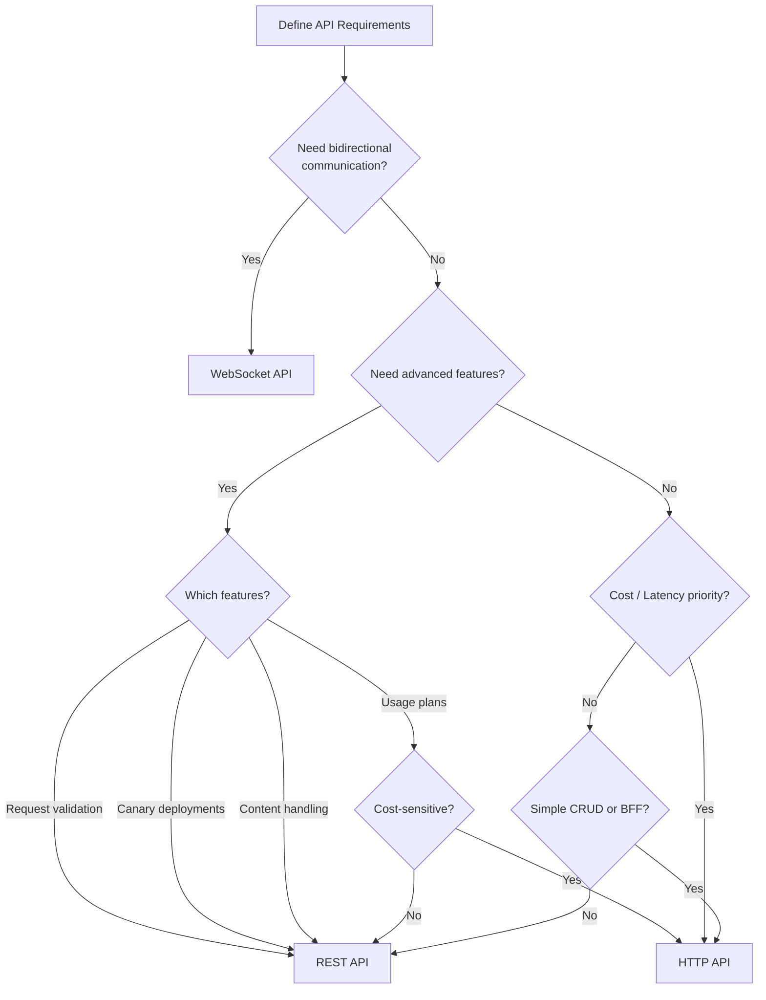
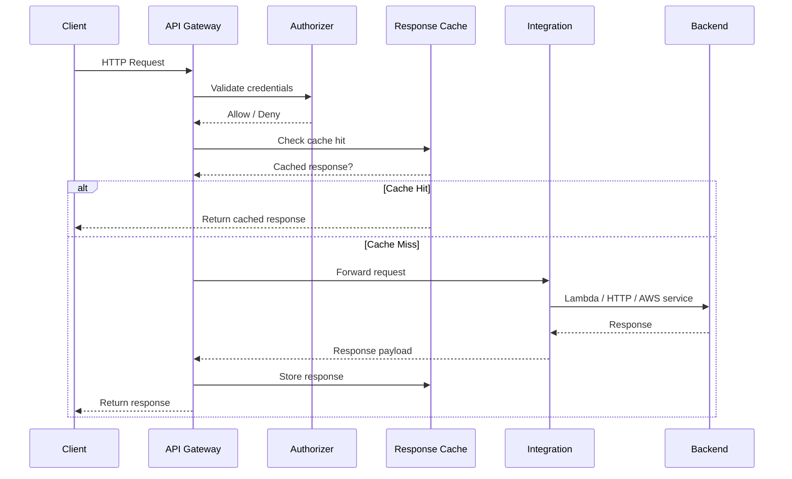

# API Gateway Best Practices

## API Types

### API Type Comparison

| Feature | REST API | HTTP API | WebSocket API |
|---------|----------|----------|---------------|
| **Latency** | Higher | Lower | Low (bidirectional) |
| **Cost** | Higher | ~70% cheaper | Per connection |
| **Authorizers** | Custom, IAM, Lambda, JWT | JWT, Lambda, IAM | Lambda |
| **Request validation** | Yes | Yes (model validation) | No |
| **Content handling** | Yes | No | No |
| **Usage plans** | Yes | No (use route-level throttling instead) | No |
| **Stage variables** | Yes | Yes | No |
| **Canary deployments** | Yes | No | No |
| **Best for** | Complex APIs, enterprise | Simple APIs, cost-sensitive | Real-time, bidirectional |

### Recommendation Matrix

| Requirement | Recommended Type |
|-------------|-----------------|
| Simple CRUD API | HTTP API |
| Complex transformations | REST API |
| Real-time communication | WebSocket API |
| Cost optimization | HTTP API |
| Low latency | HTTP API |
| Request/response validation | REST API |
| Canary deployments | REST API |
| BFF (Backend for Frontend) | HTTP API |

---

## Throttling & Quotas

### Throttling Configuration

| Level | Setting | Recommendation |
|-------|---------|---------------|
| **API-level** | Burst and rate limits | Set based on backend capacity |
| **Method-level** | Per-endpoint limits | Protect expensive operations |
| **Usage plan** | Per-API key limits | Client-level throttling |
| **Stage-level** | Stage-wide limits | Overall capacity management |

### Usage Plans (REST API only)

| Feature | Description | Use Case |
|---------|-------------|----------|
| **API key** | Identify clients | Monetization, tracking |
| **Rate limit** | Requests per second | Prevent abuse |
| **Burst limit** | Short-term spike allowance | Handle traffic spikes |
| **Quota** | Requests per time period | Tiered pricing |
| **Throttle** | Per-client limits | Fair usage |

> **Note:** Usage plans and API keys are a REST API feature. HTTP APIs do not support usage plans/API keys natively; use per-route throttling or a custom authorizer for client identification and rate control.

### Throttling Error Response

| HTTP Status | Meaning | Retry Strategy |
|-------------|---------|---------------|
| 429 | Too Many Requests | Exponential backoff |
| 503 | Service Unavailable | Exponential backoff |
| 504 | Gateway Timeout | Retry with backoff |

---

## Caching

### Stage Cache

| Setting | Recommendation | Reason |
|---------|---------------|--------|
| **Enable cache** | For idempotent GET operations | Reduce backend load |
| **Cache TTL** | Based on data freshness needs | Balance freshness and performance |
| **Cache size** | 0.6, 1.4, 2.7, 4.3, 8.3, 13.6, 28.9, 58.1 GB | Match to response size |
| **Cache key** | Include relevant headers/query params | Correct cache hits |
| **Encryption** | Enable for sensitive data | Security compliance |

### Cache Invalidation

| Method | Description | Use Case |
|--------|-------------|----------|
| **TTL expiration** | Automatic after TTL | Time-based freshness |
| **Invalidation on write** | Lambda invalidates cache | Data consistency |
| **Cache key design** | Include version/timestamp | Automatic miss on update |
| **API cache control** | Response headers | Client-side caching |

---

## Authorization

### Authorizer Types

| Type | Latency | Caching | Use Case |
|------|---------|---------|----------|
| **JWT** | Lowest | Yes (token validation) | OAuth2, Cognito |
| **Lambda (TOKEN)** | Medium | Yes (5 min) | Custom auth logic |
| **Lambda (REQUEST)** | Higher | Yes (5 min) | Header/param-based auth |
| **IAM** | Low | No | Service-to-service |
| **None** | None | N/A | Public endpoints |

### JWT Authorization

| Setting | Recommendation |
|---------|---------------|
| **Issuer** | Cognito user pool or custom provider |
| **Audience** | Your API client identifier |
| **Claims mapping** | Map to $context for downstream use |
| **Token caching** | Enable authorizer result caching |

### Security Best Practices

| Control | Implementation |
|---------|---------------|
| **Enable authorization** | On every method, not just some |
| **WAF integration** | AWS WAF for API Gateway |
| **Request validation** | Validate input at gateway |
| **Throttling** | Per-client rate limits |
| **Logging** | Enable execution logging |
| **SSL/TLS** | Require TLS 1.2 minimum |
| **API keys** | For usage tracking and monetization |

---

## Integration

### Integration Types

| Type | Description | Use Case |
|------|-------------|----------|
| **AWS** | Direct AWS service call | Lambda, S3, DynamoDB, SQS |
| **HTTP** | External HTTP endpoint | External services |
| **HTTP Proxy** | Pass-through to backend | Microservices |
| **Mock** | Static response | Testing, documentation |
| **Lambda Proxy** | Full request/response passthrough | Lambda backends |

### Lambda Integration

| Setting | Recommendation |
|---------|---------------|
| **Lambda proxy integration** | Enable for simplicity |
| **Lambda payload format** | Version 2.0 (simpler) |
| **Timeout** | REST: 29s integration timeout; HTTP: 30s; WebSocket: 30s |
| **Private Lambda** | Use VPC Link for private Lambda |
| **Canary** | Test new Lambda versions |

---

## Stages & Deployments

### Stage Strategy

| Stage | Purpose | Settings |
|-------|---------|----------|
| **dev** | Development testing | Logging enabled, cache disabled |
| **staging** | Pre-production validation | Production-like settings |
| **prod** | Production traffic | Cache enabled, throttling set |
| **v1, v2** | Versioned deployments | Canary support |

### Deployment Strategies

| Strategy | Description | Risk | Rollback |
|----------|-------------|------|----------|
| **Direct deployment** | Deploy to stage directly | Higher | Manual redeploy |
| **Canary deployment** | Gradual traffic shift | Lower | Traffic shift back |
| **Blue/Green** | Parallel environments | Lowest | Quick switch |
| **Stage variables** | Configure per stage | N/A | Variable update |

---

## Monitoring

### Key Metrics

| Metric | Warning | Critical | Description |
|--------|---------|----------|-------------|
| 4XX Error | > 1% of requests | > 5% of requests | Client errors |
| 5XX Error | > 0.1% of requests | > 1% of requests | Server errors |
| Latency | > 200ms p99 | > 500ms p99 | Response time |
| Integration Latency | > 150ms p99 | > 400ms p99 | Backend response time |
| Count | Baseline + 3σ | Baseline + 5σ | Request volume |
| Throttles | > 0 | > 10/min | Rate limit hits |

### Access Logging

| Field | Description |
|-------|-------------|
| $context.identity.cognitoIdentityId | Cognito identity |
| $context.identity.sourceIp | Client IP |
| $context.requestId | Request ID for tracing |
| $context.httpMethod | HTTP method |
| $context.resourcePath | API path |
| $context.status | Response status code |
| $context.responseLatency | Total latency |
| $context.integrationLatency | Backend latency |

---

## Cost Optimization

| Strategy | Description | Potential Savings |
|----------|-------------|-------------------|
| **Use HTTP API** | Instead of REST API | ~70% reduction |
| **Enable caching** | Reduce backend invocations | Backend cost reduction |
| **Right-size cache** | Match to actual needs | Cache cost optimization |
| **Compression** | Enable response compression | Data transfer reduction |
| **Stage consolidation** | Fewer stages | Per-stage cost reduction |
| **Usage plan tiers** | Match to client needs | Revenue optimization |

### Cost Comparison

| Component | REST API | HTTP API |
|-----------|----------|----------|
| **API calls (per M)** | $3.50 | $1.00 |
| **Data transfer (per GB)** | $0.09 | $0.09 |
| **Cache (per GB-hour)** | $0.008 | Not available |
| **Authorizer (per M)** | $3.50 | $1.00 |
| **WebSocket connections** | N/A | Per active connection-hour + data |

---

## Cross-Service Integration

| Service | Integration | Purpose |
|---------|------------|---------|
| Lambda | Backend processing | Serverless compute |
| Cognito | JWT authorization | User authentication |
| WAF | Web application firewall | Security |
| CloudWatch | Logging, metrics | Monitoring |
| X-Ray | Distributed tracing | Debugging |
| CloudFront | Edge caching | Global delivery |
| Step Functions | Workflow orchestration | Complex workflows |
| AppSync | GraphQL on top | GraphQL APIs |
