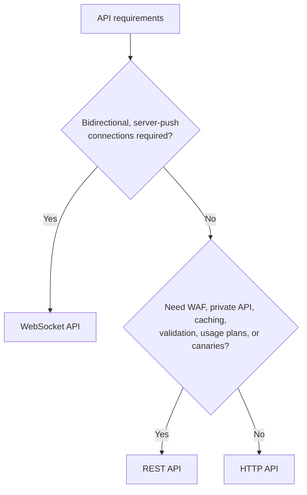
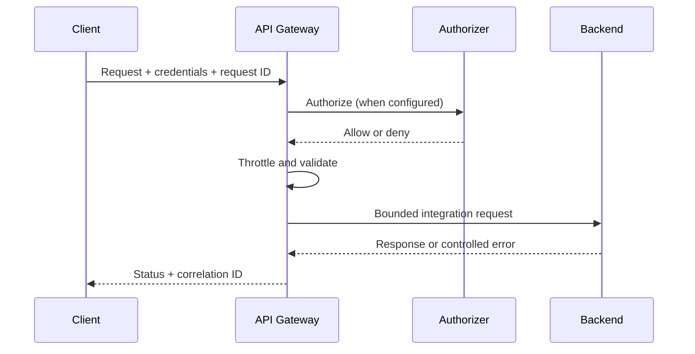

# Amazon API Gateway Best Practices

Choose an API type from required features and client behavior, then protect the backend with explicit authorization, validation, throttling, observability, and failure handling.

## Choose the API Type

| Capability | REST API | HTTP API | WebSocket API |
|---|---|---|---|
| Primary model | Request/response with extensive API-management features | Lower-cost, lower-latency HTTP proxy/API | Stateful, bidirectional connections and routes |
| IAM authorization | Yes | Yes | Yes |
| Native JWT authorizer | No (use Cognito user-pool or Lambda authorizer) | Yes | No (use Lambda authorizer for `$connect`) |
| Lambda authorizer | Yes | Yes | Yes, on `$connect` |
| API keys and usage plans | Yes | No | No |
| Request validation | Parameters and body models | No | Route body models selected by an expression |
| Response cache | Yes | No | No |
| AWS WAF association | Yes | No | No |
| Private API endpoint | Yes | No | No |
| Canary release | Yes | No | No |
| Access logs | Yes | Yes | Yes |
| Execution logs / X-Ray | Yes / Yes | No / No | Yes / No |

Use an HTTP API when its smaller feature set is sufficient. Choose a REST API for request validation, response caching, WAF, private endpoints, resource policies, API keys/usage plans, transformations, or canaries. Choose WebSocket only when the server must push over long-lived connections; otherwise normal HTTP is simpler to operate.

## Endpoint and Network Design

- Use Regional endpoints unless an edge-optimized REST endpoint is specifically required. A CloudFront distribution that you control provides more CDN and security flexibility.
- Use private REST APIs with interface VPC endpoints and resource policies when clients must remain inside permitted VPCs/accounts.
- A VPC link is for private HTTP integrations such as an ALB, NLB, or Cloud Map-discovered service. It is **not** needed to invoke a Lambda function, including a VPC-connected function.
- Protect origins so clients cannot bypass API Gateway or an intentionally placed CloudFront distribution.
- Use custom domains, DNS failover only where the application is actually multi-Region, and certificate-renewal alarms.

## Authorization and API Keys

| Mechanism | Good fit | Important controls |
|---|---|---|
| IAM/SigV4 | AWS workloads and service-to-service calls | Least-privilege `execute-api:Invoke`, resource policies, source VPC/account conditions |
| HTTP API JWT authorizer | OAuth 2.0/OIDC access tokens | Validate issuer and audience; require route scopes; use access tokens rather than ID tokens for API authorization |
| Cognito user-pool authorizer (REST) | Cognito-issued tokens | Configure methods/scopes deliberately and validate claims in the integration as needed |
| Lambda authorizer | Custom credentials or policy logic | Fail closed, bound result-cache TTL, include all identity sources that affect the decision |
| Mutual TLS | Client-certificate authentication on supported REST/HTTP custom domains | Maintain truststore versioning, rotation, revocation strategy, and domain ownership |

API keys are identifiers for usage plans, metering, and throttling. They are not authentication or authorization credentials and can be extracted by clients. Never use an API key alone to protect sensitive data or operations.

- Require authorization on every non-public route, including new routes created later.
- Keep authorization logic independent of untrusted client-supplied identity fields.
- Be careful with authorizer caching: a cached allow policy must be valid for every route/resource represented by its cache key.
- Disable the default `execute-api` endpoint when all traffic must use a controlled custom domain, if supported for the API type and deployment.

## Validation and Transformations

REST API request validation can check required request parameters and validate a body against a configured model. WebSocket routes can select a JSON-schema body model with a model selection expression. Neither is a full business-rule or security validator, and HTTP APIs do not provide native request validation.

- Enforce body, header, query, and path constraints again in the backend.
- Set explicit content types and binary-media behavior; reject unsupported or ambiguous formats.
- Keep mapping templates and parameter mappings in version control with contract tests.
- Bound request/response payload sizes and use S3 pre-signed URLs for large uploads or downloads.
- Return consistent, non-sensitive error bodies and correlation identifiers.

## Throttling and Quotas

API Gateway throttling uses token-bucket targets and is best effort. Account/Region, API/stage, route/method, and REST usage-plan limits can all apply; the effective lower limit wins.

| Layer | Purpose |
|---|---|
| Account/Region quota | Shared ceiling across APIs; request an increase only after checking backend capacity |
| Stage/API default | Protect the deployment as a whole |
| Route or method | Constrain expensive or latency-sensitive operations |
| REST usage plan | Best-effort quota and throttle by API key for client tiers |
| Backend controls | Protect databases and dependencies with concurrency, queues, circuit breakers, and application quotas |

- Load test end to end. A higher gateway quota can overload Lambda concurrency, database connections, or third-party APIs.
- Return `429` with a useful `Retry-After` policy where possible. Clients should use exponential backoff with jitter and retry only idempotent operations or operations protected by idempotency keys.
- Do not use usage-plan quotas as cost or access-control boundaries; AWS documents them as best effort.

## REST API Caching

Stage caching is available only for REST APIs and is provisioned per stage.

| Setting | Guidance |
|---|---|
| Methods | Cache safe, idempotent reads; do not cache personalized responses without identity-aware keys |
| Cache key | Include every header, query string, path parameter, or identity attribute that changes the response |
| TTL | Set from freshness requirements; REST API cache TTL can be configured up to 3,600 seconds |
| Encryption | Enable cache-data encryption when responses contain sensitive data |
| Capacity | Load test each available cluster size; resizing deletes cached data and can take several minutes |
| Invalidation | Prefer TTL/versioned keys; flushing clears the stage cache, and client invalidation must be explicitly authorized |

API Gateway stage caching is not CloudFront caching. If CloudFront is used, define its cache policy independently and avoid caching authenticated/error responses accidentally.

## Integrations and Timeouts

| Integration | Guidance |
|---|---|
| Lambda proxy | Prefer for simple Lambda APIs; HTTP API supports payload format versions `1.0` and `2.0` |
| AWS service | Use direct integrations when no custom compute logic is needed |
| HTTP proxy | Preserve a simple pass-through contract and secure the public origin |
| Private HTTP | Use a VPC link to supported private ALB/NLB/Cloud Map targets |
| Mock (REST) | Static/testing responses and CORS preflight patterns |

- Set the integration timeout from measured backend latency and the API type's current quota. REST Regional/private APIs can request integration timeouts above the traditional limit, potentially in exchange for a lower account throttle quota; do not hard-code “29 seconds” as universal.
- Align Lambda timeout, SDK timeouts, load-balancer idle timeout, and client timeout so failures occur predictably.
- Prefer asynchronous job submission plus a status resource for work that can exceed the synchronous request window.
- For retries and client disconnects, make mutations idempotent and propagate a request/idempotency identifier.

## Deployments and Change Safety

- Define APIs, stages, routes, integrations, authorizers, domains, logging, and alarms as infrastructure as code.
- Use explicit deployments for REST APIs. For HTTP APIs, decide deliberately whether `$default` stage auto-deploy is acceptable.
- Use REST canary deployments or separate blue/green stages/domains for progressive delivery. Ensure Lambda aliases and stage variables cannot drift from the intended version.
- Contract-test generated OpenAPI definitions and verify authorization on every route before promotion.
- Avoid putting secrets in stage variables; they are configuration, not a secret store.

## Logging and Monitoring

Enable structured access logs with fields supported by the API type. At minimum capture request ID, extended request ID where available, route, status, response/integration latency, source IP, user agent, and authenticated principal/authorizer outcome without tokens or secrets.

| Signal | Operational use |
|---|---|
| `Count` | Traffic baseline and anomaly detection |
| `4XXError` | Separate expected client failures, authorization denials, validation errors, and throttles |
| `5XXError` | Gateway/integration failure rate |
| `Latency` and `IntegrationLatency` | Distinguish gateway overhead from backend latency |
| `CacheHitCount` / `CacheMissCount` | REST cache effectiveness |
| Integration and Lambda metrics | Backend throttles, errors, concurrency, and saturation |

Do not use universal warning percentages. Build service-level objectives from each API's business requirements, then alarm on error-budget burn and sustained anomalies. REST execution logging can expose request/response data; do not enable full data tracing in production unless necessary and sanitized.

## Cost Management

Prices vary by API type, Region, request tier, cache size, data transfer, logging, and integrations. HTTP APIs are generally less expensive than REST APIs, but they are not a feature-for-feature replacement.

- Use HTTP APIs when required features permit.
- Remove unused REST cache clusters and use backend/CDN caching when it better matches the workload.
- Reduce payload size and avoid verbose production logs.
- Direct AWS service integrations can remove Lambda invocation and duration cost.
- Review the current pricing page and calculator; do not model authorizers as a universal separate per-request API Gateway charge.

## Authoritative References

- [Choose between REST APIs and HTTP APIs](https://docs.aws.amazon.com/apigateway/latest/developerguide/http-api-vs-rest.html)
- [API Gateway throttling](https://docs.aws.amazon.com/apigateway/latest/developerguide/api-gateway-request-throttling.html)
- [REST API caching](https://docs.aws.amazon.com/apigateway/latest/developerguide/api-gateway-caching.html)
- [HTTP API JWT authorizers](https://docs.aws.amazon.com/apigateway/latest/developerguide/http-api-jwt-authorizer.html)
- [WebSocket API request validation](https://docs.aws.amazon.com/apigateway/latest/developerguide/websocket-api-request-validation.html)
- [Private integrations for HTTP APIs](https://docs.aws.amazon.com/apigateway/latest/developerguide/http-api-develop-integrations-private.html)
- [API Gateway logging best practices](https://docs.aws.amazon.com/apigateway/latest/developerguide/security-best-practices.html)
- [API Gateway quotas](https://docs.aws.amazon.com/apigateway/latest/developerguide/limits.html)
- [API Gateway pricing](https://aws.amazon.com/api-gateway/pricing/)
