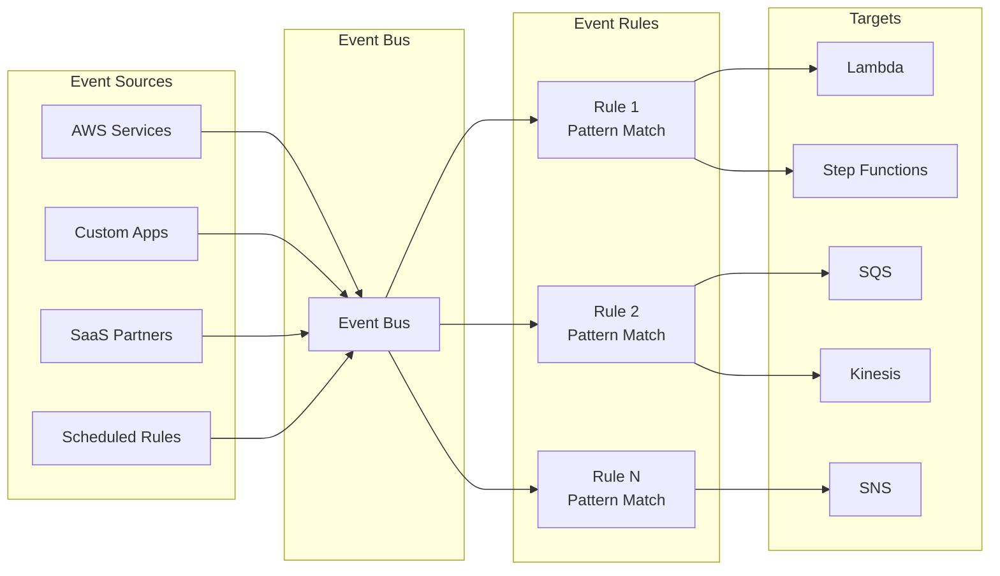
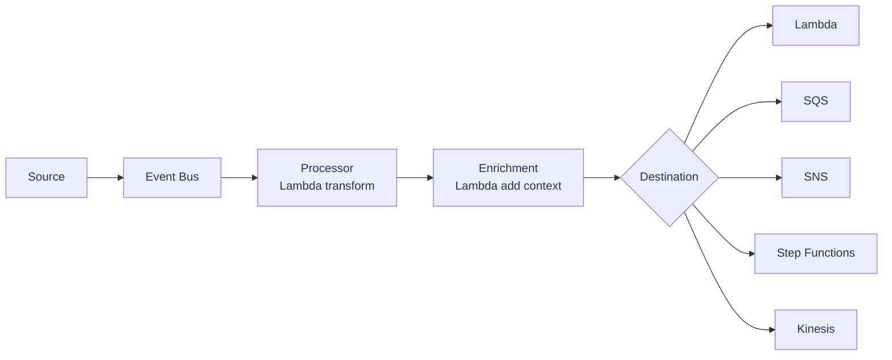

# EventBridge Best Practices

## Architecture

### EventBus Types

| Type | Description | Use Case |
|------|-------------|----------|
| **Default Event Bus** | Receives events from AWS services | Standard event processing |
| **Custom Event Bus** | User-created, isolated | Application-specific events |
| **Partner Event Bus** | SaaS partner events | Third-party integration |
| **Archive** | Store events for replay | Debugging, compliance |
| **Replay** | Re-process archived events | Recovery, testing |

### Event Routing

| Component | Description | Direction |
|-----------|-------------|-----------|
| **Event Source** | Produces events | Inbound to bus |
| **Event Bus** | Routes events | Central hub |
| **Rule** | Matches and routes events | Pattern matching |
| **Target** | Receives routed events | Outbound from bus |

---

## Event Pattern Design

### Pattern Matching

| Field | Operators | Description |
|-------|-----------|-------------|
| account | =, != | AWS account ID |
| time | =, !=, >, <, >=, <= | Event timestamp |
| region | =, != | AWS region |
| source | =, !=, begins-with | Event source |
| detail-type | =, !=, begins-with | Event type |
| resources | =, !=, begins-with | Resource ARNs |
| detail | =, !=, >, <, exists | Custom event data |

### Event Design Guidelines

| Guideline | Description | Example |
|-----------|-------------|---------|
| **Consistent format** | Standardize event structure | id, source, time, type, detail |
| **Include correlation ID** | Trace across services | UUID in detail |
| **Version events** | Handle schema changes | version field in detail |
| **Minimal data** | Only necessary fields | Avoid large payloads |
| **Idempotent targets** | Safe to replay | Deduplication logic |
| **Meaningful detail-type** | Easy filtering | "Order Created", "User Updated" |

---

## Rules

### Rule Configuration

| Setting | Recommendation | Reason |
|---------|---------------|--------|
| **Rule name** | Descriptive, prefixed by domain | Easy identification |
| **Event pattern** | Specific enough to avoid noise | Reduce unnecessary processing |
| **Schedule** | Cron or rate for periodic events | Scheduled tasks |
| **Target retry** | Default 180 days | Long retry window |
| **Dead-letter queue** | Always configure | Capture permanent failures |
| **Input transformer** | Transform before target | Reduce target complexity |

### Rule Types

| Type | Description | Use Case |
|------|-------------|----------|
| **Event pattern** | Match incoming events | Event-driven processing |
| **Schedule (rate)** | Fixed interval | Periodic tasks |
| **Schedule (cron)** | Cron expression | Complex schedules |

---

## Targets

### Supported Targets

| Target | Description | Configuration |
|--------|-------------|---------------|
| **Lambda** | Invoke function | Function ARN, qualifier |
| **SQS** | Send message | Queue ARN, group ID (FIFO) |
| **SNS** | Publish notification | Topic ARN |
| **Step Functions** | Start state machine | State machine ARN |
| **EC2** | Run instances | Instance IDs |
| **Kinesis** | Put record | Stream ARN |
| **CodeBuild** | Start build | Project name |
| **Grafana** | Send metric | Workspace ID |

### Target Configuration

| Setting | Recommendation |
|---------|---------------|
| **Retry policy** | Use default (180 days) |
| **Dead-letter queue** | Always configure SQS DLQ |
| **Input path** | Transform event before sending |
| **Input transformer** | Extract specific fields |
| **HttpParameters** | For API destinations |

---

## Error Handling

### Retry Behavior

| Target | Retry Duration | Backoff | Notes |
|--------|---------------|---------|-------|
| Lambda | 180 days | Exponential | Configurable DLQ |
| SQS | 180 days | Exponential | Queue handles retries |
| SNS | 180 days | Exponential | Subscribers handle retries |
| Step Functions | 180 days | Exponential | Execution handles retries |
| Kinesis | 180 days | Exponential | Stream handles retries |
> **Note:** 180-day retry is default; can be disabled per target. |

### Dead-Letter Queue

| Setting | Recommendation |
|---------|---------------|
| **Always configure DLQ** | For all rules with Lambda targets |
| **DLQ retention** | Match compliance requirements |
| **DLQ monitoring** | Alert on messages in DLQ |
| **DLQ processing** | Lambda to process DLQ messages |

---

## Schema Registry

### Event Schema Management

| Feature | Description | Use Case |
|---------|-------------|----------|
| **Schema discovery** | Auto-discover event schemas | Event catalog |
| **Schema registry** | Store and version schemas | Schema governance |
| **Code generation** | Generate SDK code | Type-safe event handling |
| **Schema validation** | Validate events against schema | Data quality |

---

## Pipelines

### EventBridge Pipelines

| Component | Description |
|-----------|-------------|
| **Source** | Event source (EventBus, S3, etc.) |
| **Processor** | Transform/enrich (Lambda) |
| **Enrichment** | Add data (Lambda) |
| **Destination** | Target service |
| **Parameters** | Configuration |

### Pipeline Use Cases

| Use Case | Components | Description |
|----------|-----------|-------------|
| **Data enrichment** | Source + Enrichment + Destination | Add context to events |
| **Format transformation** | Source + Processor + Destination | Convert event format |
| **Filtering** | Source + Processor + Destination | Filter events before target |
| **Multi-destination** | Source + Processor + Multiple destinations | Fan-out with transformation |

---

## Monitoring

### Key Metrics

| Metric | Description | Alert Threshold |
|--------|-------------|----------------|
| IncomingEvents | Events received by bus | Sudden drop/spike |
| FailedEvents | Events that failed delivery | > 0 sustained |
| DeletedEvents | Events deleted from archive | Monitor for cleanup |
| ReplayedEvents | Events from replay | During replay operations |
| PublishedEvents | Events sent to targets | Match incoming events |
| MatchedEvents | Events matching rules | Validate rule patterns |

### Best Practices

| Practice | Description |
|----------|-------------|
| **Monitor DLQ** | Alert on messages in dead-letter queues |
| **Track latency** | Time from event to target processing |
| **Archive critical events** | For debugging and compliance |
| **Use X-Ray** | For distributed tracing |
| **CloudWatch Logs** | For rule evaluation logs |

---

## Cost Optimization

| Strategy | Description | Potential Savings |
|----------|-------------|-------------------|
| **Specific event patterns** | Reduce unnecessary rule matches | Lower target invocations |
| **Right-size archives** | Set retention period | Storage cost reduction |
| **Custom buses** | Isolate high-volume events | Better cost tracking |
| **Input transformers** | Reduce payload to targets | Lower target costs |
| **Batch targets** | SQS batching | Fewer target invocations |

### Pricing

| Component | Price |
|-----------|-------|
| **Events put** | $1.00 per 1M events |
| **Events matched** | $1.00 per 1M events |
| **Archive storage** | $0.50 per GB-month |
| **Replay** | $1.00 per 1M events |
| **Schema registry** | $1.00 per 1M API calls |

---

## Cross-Service Integration

| Service | Integration | Purpose |
|---------|------------|---------|
| Lambda | Primary target | Event processing |
| SQS | Decoupled processing | Reliable message delivery |
| SNS | Fan-out notifications | Multiple subscribers |
| Step Functions | Workflow orchestration | Complex workflows |
| S3 | Event source | Object change events |
| Kinesis | Stream processing | Real-time data |
| CodePipeline | CI/CD triggers | Automated deployments |
