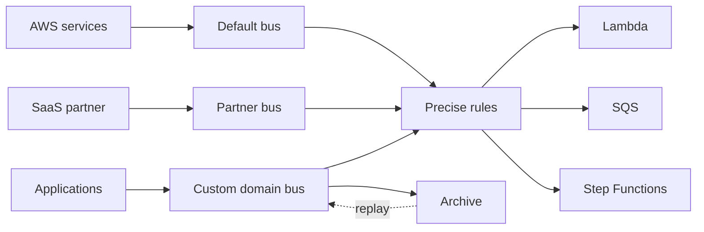
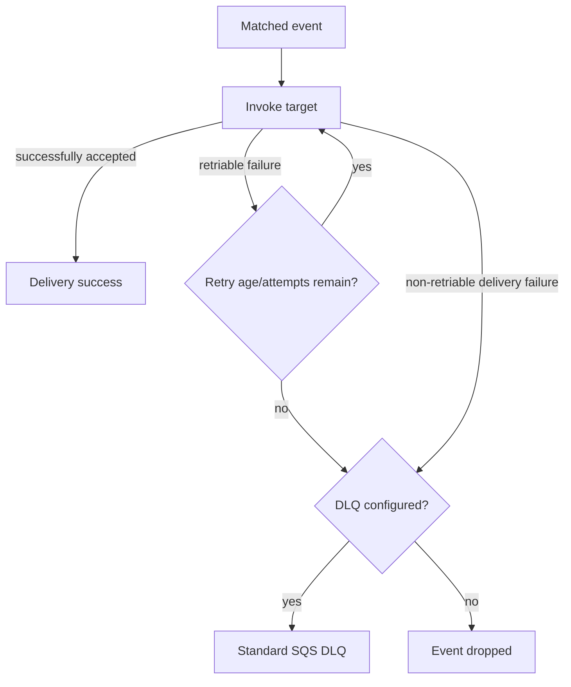
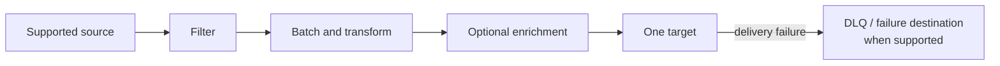

# Amazon EventBridge Best Practices

Amazon EventBridge routes events; it is not a durable work queue for consumers. Design producers and targets for at-least-once delivery, duplicates, retries, delayed delivery, and partial failure.

## Select the Right EventBridge Capability

Choosing the wrong capability introduces unnecessary latency, cost, and operational complexity. Match the capability to the routing pattern and delivery guarantees your system actually needs.

| Capability | Use it for | Key characteristic |
|---|---|---|
| Event bus + rules | Many-to-many event routing and fan-out | Rules match events and deliver independently to targets |
| Archive and replay | Retaining bus events and replaying them later | Replay is asynchronous and sends events back through the source event bus |
| Pipes | Point-to-point integration from a supported source to one target | Managed polling, filtering, batching, optional enrichment, transformation, and delivery |
| Scheduler | One-time or recurring invocations | Time zones, daylight-saving behavior, flexible windows, retries, DLQ, and broad AWS API target support |
| Schema Registry | Discovering/cataloging schemas and generating code bindings | Registry does **not** validate events as they are published or delivered |

The default event bus receives supported AWS service events. Use custom buses to create ownership, policy, encryption, and operational boundaries for application domains. Partner event sources are associated with partner event buses.

## Event Contracts

Custom events should follow the EventBridge envelope and put domain data under `detail`.

Consistent field conventions reduce consumer parsing errors and make cross-service correlation tractable.

| Field | Guidance |
|---|---|
| `source` | Stable, owned namespace such as `com.example.orders` |
| `detail-type` | Business fact in past tense, such as `Order Accepted` |
| `detail` | Minimal event data and stable identifiers; do not put secrets in events |
| Version | Version the business schema in `detail` or via an explicit contract strategy |
| Correlation | Include correlation/causation IDs and a stable event/business ID |
| Time | Preserve the time the fact occurred when it differs from publication time |

- Publish facts, not commands disguised as events, when multiple consumers may react independently.
- Define compatibility rules. Prefer additive optional fields; consumers should ignore unknown fields.
- Put large or sensitive payloads in an appropriate data store and send an authorized reference, accounting for consistency and expiry.
- Treat delivery as at least once. Make consumers idempotent with a business key or event ID and an atomic state transition.
- Give producers ownership of schema documentation and deprecation; do not rely on discovery as governance.

## Event Pattern Design

Event patterns are structural JSON filters. Values are arrays; omitted fields are ignored. String matching is exact and case-sensitive unless an operator such as `equals-ignore-case` is used. Numeric equality without the numeric operator is based on JSON string representation.

Picking the right operator prevents silent rule mismatches and keeps fan-out predictable as event schemas evolve.

| Operator/pattern | Use |
|---|---|
| Exact values | Known `source`, `detail-type`, account, Region, state, or identifier |
| `anything-but` | Exclude known values |
| `prefix`, `suffix`, `wildcard` | String patterns; wildcard support and complexity rules differ for buses and Pipes |
| `numeric` | Numeric ranges and comparisons |
| `exists` | Presence/absence of a leaf field |
| `cidr` | IP network matching |
| `$or` | Alternatives across multiple fields |

- Always constrain `source` and `detail-type`; for CloudTrail-delivered events also constrain `detail.eventSource` and `detail.eventName`.
- Avoid duplicate JSON keys. EventBridge uses only the final duplicate and behavior can be surprising.
- Test patterns with the EventBridge Sandbox or `TestEventPattern`, including non-matching and future-compatible samples.
- Prevent loops by ensuring a rule cannot match events produced by its own target, or by adding a source/status guard.
- Use input transformers for simple projection and templating, not business logic or security validation.

## Rules, Delivery, and Failure Handling

Each rule target has its own role/permissions, retry policy, and optional DLQ. A match is not proof of successful target delivery.

Misconfigured retry and DLQ settings are the most common cause of silent data loss or unbounded event age.

| Setting | Guidance |
|---|---|
| Retry policy | Default is up to 24 hours and 185 attempts with exponential backoff and jitter; reduce age/attempts only when stale events are harmful |
| DLQ | Configure for targets where dropping an undelivered event is unacceptable |
| Target role | Grant only the action and resource needed by that target |
| Target input | Pass the original event when audit/context matters; transform only to a documented target contract |
| Fan-out | Prefer separate targets/rules when retry, transformation, ownership, or failure isolation differs |

EventBridge target DLQs use **standard SQS queues**, not FIFO queues, and the queue must be in the same Region as the rule. Configure the queue resource policy so EventBridge can send messages. A DLQ captures events EventBridge could not deliver to the target after retries, including certain non-retriable failures; it does not capture an event after the target successfully accepts it and later fails internally.

- Alarm on DLQ depth and build a controlled redrive process that preserves idempotency.
- If durable buffering/backpressure is required, route to SQS and let consumers process from the queue.
- Archive critical domain events when replay is a valid recovery tool. Set retention from recovery/compliance needs and test replay against non-production consumers first.
- Replay preserves event contents but changes delivery context; consumers must recognize duplicates and should be safe against replaying old side effects.

## Cross-Account and Security

- Restrict custom event-bus resource policies by organization, account, principal, source, and action as narrowly as possible.
- For cross-account routing, configure both the destination bus policy and the sender's IAM permissions. Costs are charged according to the current cross-account pricing model.
- Use dedicated IAM roles for targets and Pipes. Do not reuse broad application roles.
- EventBridge encrypts data at rest by default. Use a customer managed KMS key only when key-policy control and audit requirements justify its operational dependencies.
- Keep credentials for API Destinations in EventBridge Connections/Secrets Manager and rotate them; do not include credentials in event payloads.
- Use CloudTrail for control-plane and supported data-event auditing, and protect archives, DLQs, and log targets with appropriate encryption and access policies.

## EventBridge Pipes

Pipes are for one source-to-one-target flows. Supported sources include SQS, Kinesis Data Streams, DynamoDB Streams, Amazon MSK, self-managed Apache Kafka, and Amazon MQ; consult the current documentation because source/target options evolve.

- Filter before enrichment to avoid unnecessary calls. Filtered SQS messages are deleted; filtered stream records are skipped, so validate filters carefully.
- Tune batch size/window from the target payload limit and per-record processing cost.
- Enrichment is synchronous in the pipe path; bound latency and failure behavior.
- Understand source-specific retry semantics. SQS visibility/redrive differs from ordered stream retry/record-age behavior.
- Configure partial batch failure where the source/target combination supports it and make targets idempotent.
- Monitor pipe state: persistent authorization/configuration failures can cause a pipe to stop or become disabled.

## EventBridge Scheduler

Scheduled rules are a legacy capability. Prefer EventBridge Scheduler for new schedules.

Scheduler settings directly affect invocation reliability, quota consumption, and the risk of orphaned completed schedules.

| Setting | Recommendation |
|---|---|
| Time expression | Use `at` for one-time work and `rate`/`cron` for recurring work |
| Time zone/DST | Choose an IANA time zone deliberately and test daylight-saving behavior |
| Flexible window | Use it to smooth load when exact invocation time is unnecessary |
| Retry and DLQ | Configure maximum event age/attempts and a standard SQS DLQ based on business expiry |
| One-time cleanup | Set `ActionAfterCompletion=DELETE`; completed schedules otherwise count toward quota |
| Idempotency | The target must tolerate duplicate invocations |
| Execution role | Scope to the one target API/resource required |

Check Scheduler quotas for schedules and invocation throughput in each Region. Spread large fleets with flexible windows and request quota increases before migration.

## Monitoring

Use `AWS/Events` metrics with the correct `EventBusName` and `RuleName` dimensions.

These metrics distinguish matching from delivery and expose retries, DLQ pressure, and latency before business impact occurs.

| Metric | Meaning/action |
|---|---|
| `MatchedEvents` | Events matched by a bus/rule; compare with expected producer volume |
| `InvocationAttempts` | Target delivery attempts, including first attempts and retries |
| `SuccessfulInvocationAttempts` | Successfully delivered target invocations |
| `RetryInvocationAttempts` | Early warning for throttled or unhealthy targets |
| `FailedInvocations` | Permanent failures after retry handling; alarm when nonzero |
| `InvocationsSentToDlq` | Events sent to the configured DLQ |
| `InvocationsFailedToBeSentToDlq` | DLQ permissions, availability, or size failure; high severity |
| `IngestionToInvocationSuccessLatency` | End-to-end delivery latency including retries |

Metrics are best effort, so use target metrics, DLQ inspection, CloudTrail, and business reconciliation for complete operational assurance. EventBridge does not provide end-to-end application tracing automatically; propagate correlation IDs and instrument producers/consumers.

## Cost Management

Charges vary among custom/partner events, cross-account delivery, archives/replay, Pipes, Scheduler, API Destinations, and targets. Current pricing and free tiers change.

- Make patterns precise to reduce unnecessary target work and avoid loops.
- Set archive retention intentionally and delete obsolete archives/replays.
- Filter Pipes before enrichment and target invocation.
- Use batching where supported, without exceeding target payload limits or latency requirements.
- Evaluate total cost: EventBridge delivery plus Lambda, SQS, logs, data transfer, enrichment, and downstream calls.

## Authoritative References

- [EventBridge events and event buses](https://docs.aws.amazon.com/eventbridge/latest/userguide/eb-events.html)
- [Event pattern syntax and operators](https://docs.aws.amazon.com/eventbridge/latest/userguide/eb-create-pattern.html)
- [Event pattern best practices](https://docs.aws.amazon.com/eventbridge/latest/userguide/eb-patterns-best-practices.html)
- [EventBridge target retry policy](https://docs.aws.amazon.com/eventbridge/latest/userguide/eb-rule-retry-policy.html)
- [EventBridge dead-letter queues](https://docs.aws.amazon.com/eventbridge/latest/userguide/eb-rule-dlq.html)
- [EventBridge monitoring and metrics](https://docs.aws.amazon.com/eventbridge/latest/userguide/eb-monitoring.html)
- [EventBridge Pipes](https://docs.aws.amazon.com/eventbridge/latest/userguide/eb-pipes.html)
- [What is EventBridge Scheduler?](https://docs.aws.amazon.com/scheduler/latest/UserGuide/what-is-scheduler.html)
- [EventBridge Scheduler quotas](https://docs.aws.amazon.com/scheduler/latest/UserGuide/scheduler-quotas.html)
- [EventBridge quotas](https://docs.aws.amazon.com/eventbridge/latest/userguide/eb-quota.html)
- [EventBridge pricing](https://aws.amazon.com/eventbridge/pricing/)
