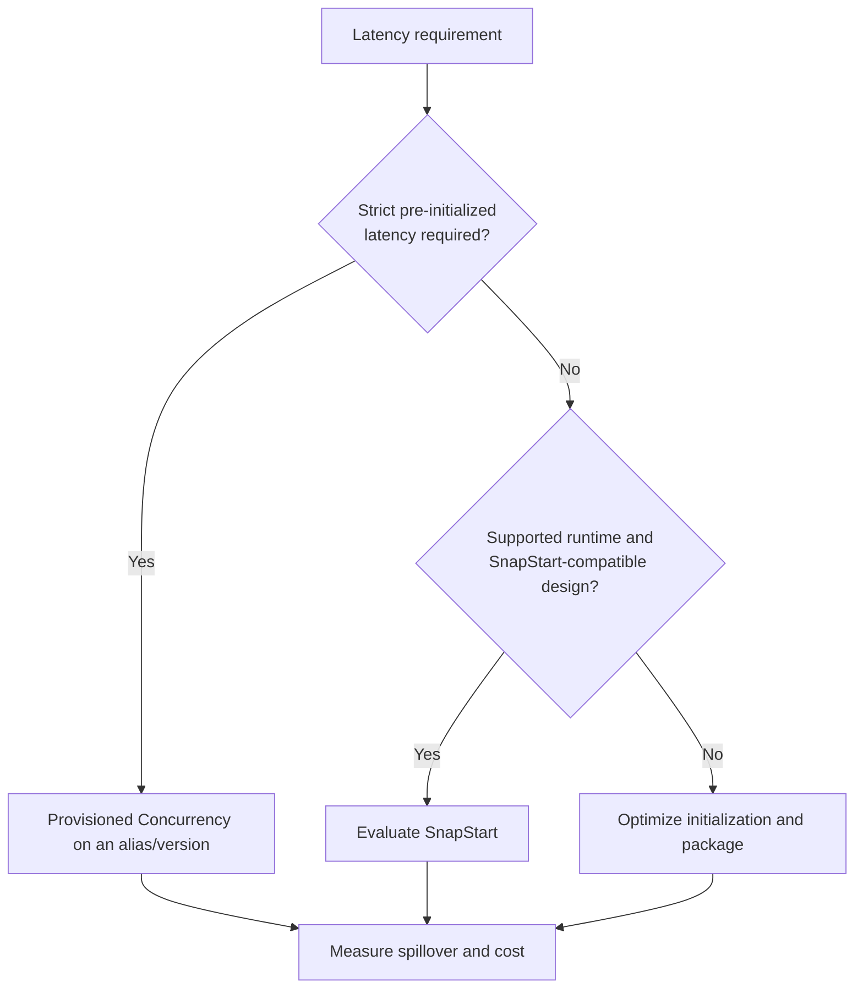
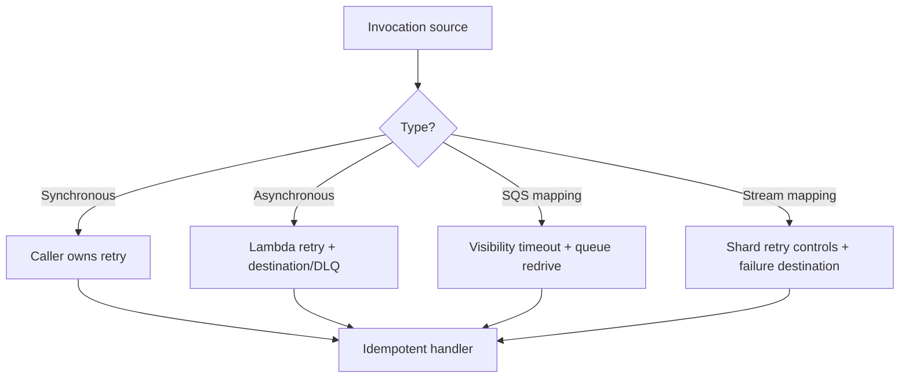

# AWS Lambda Best Practices

Design Lambda functions as short-lived, stateless compute units while taking advantage of safe execution-environment reuse. Delivery semantics, retries, and failure destinations depend on the invocation source; there is no single Lambda retry policy for every trigger.

## Function Design

Functions that follow disciplined design patterns are easier to test, scale, and maintain. These practices reduce coupling, surface failures early, and keep costs predictable.

| Concern | Best practice |
|---|---|
| Scope | Keep one function focused on a cohesive capability and event contract |
| Handler | Keep orchestration thin; isolate business logic from Lambda-specific input/output for testing |
| Idempotency | Make side effects safe under duplicate delivery and retries; persist an idempotency key atomically |
| Initialization | Create SDK clients, database connections, and reusable assets outside the handler |
| State | Treat memory and `/tmp` as a cache only; never require reuse for correctness or user isolation |
| Configuration | Use environment variables for non-secret settings and a managed secret store for credentials |
| Deployment | Publish immutable versions and route aliases to versions for production |

Initialize reusable resources outside the handler, contrary to the common but harmful advice to move initialization into the handler. Validate that reused connections remain alive, and never store per-user sensitive state where a later invocation can observe it.

## Configuration and Quotas

Right-sizing these settings directly affects latency, throughput, and cost. Misconfigured limits cause throttling, silent failures, or unexpected bills.

| Setting | Current service boundary / guidance |
|---|---|
| Timeout | Up to 900 seconds; load test and set enough margin for dependency latency and cleanup |
| Memory | 128–10,240 MB in 1 MB increments; CPU scales with memory |
| CPU | At 1,769 MB a function receives the equivalent of one vCPU; at maximum memory it can receive up to six vCPUs |
| Ephemeral storage | 512–10,240 MB; storage above 512 MB is billed for invocation duration |
| Architecture | Benchmark `arm64` and `x86_64` with the real dependencies; ensure native binaries support the target |
| Concurrency | The default regional account quota is commonly 1,000 but can be lower for new accounts and is adjustable |
| Environment variables | Aggregate limit is 4 KB; encryption does not make them an appropriate secret-distribution mechanism |

- Use AWS Lambda Power Tuning or representative load tests to select memory from cost **and** latency, not rules of thumb.
- Set reserved concurrency to reserve/cap capacity for critical functions or protect a downstream system. Reserving it unnecessarily reduces the shared unreserved pool.
- Configure maximum concurrency on SQS event source mappings when the queue consumer must not overwhelm dependencies.
- Confirm quotas in Service Quotas for every target Region before launch; do not assume the account default.

## Cold Starts and Execution Reuse

Cold starts and execution reuse determine the latency profile your users actually experience. Choosing the right technique depends on runtime, cost tolerance, and whether you need a guarantee.

| Technique | Important nuance |
|---|---|
| Execution reuse | Move clients/connections outside the handler and cache static assets in `/tmp` |
| Package reduction | Include only runtime dependencies; measure impact instead of assuming size is the only cold-start factor |
| Memory tuning | More memory adds CPU and can reduce initialization/duration, but benchmark total cost |
| Provisioned Concurrency | Keeps a configured number of environments initialized; overflow beyond it can still cold start |
| SnapStart | Available for supported Java, Python, and .NET managed runtimes on published versions; restore from a snapshot rather than keeping capacity provisioned |

SnapStart is incompatible with Provisioned Concurrency, EFS, S3 Files, container images, and ephemeral storage above 512 MB. Initialization state is cloned, so reseed uniqueness, refresh credentials/connections, and use runtime hooks where needed. Availability, supported runtime versions, Regions, and pricing evolve; verify them before standardizing.

VPC attachment is no longer accurately described as creating a new ENI for every cold start; Lambda uses Hyperplane ENIs. Put a function in a VPC only when it needs VPC resources. A VPC-connected function does not retain default internet access—provide NAT or appropriate VPC endpoints. Endpoints improve private connectivity and security, not cold-start initialization by themselves.

Scheduled “keep warm” invocations are not a dependable cold-start guarantee and create noise/cost. Use Provisioned Concurrency when a guarantee is required.

## Invocation and Retry Semantics

Different invocation sources handle failures independently, so understanding each path is essential to avoid duplicate processing or swallowed errors.

| Invocation path | Failure behavior |
|---|---|
| Synchronous (`RequestResponse`) | Lambda returns the error; the caller/source decides whether to retry |
| Asynchronous (`Event`) | Lambda queues the event and by default retries function errors twice; maximum event age, retry attempts, destinations, and DLQ are configurable |
| SQS event source mapping | Lambda polls; failed messages become visible after the queue visibility timeout and the queue redrive policy controls movement to its DLQ |
| Kinesis/DynamoDB stream mapping | Failed batches can block a shard; configure partial failures, bisect, maximum record age/retries, and an on-failure destination as appropriate |
| Kafka/MQ/document DB mappings | Source-specific polling, batching, and retry semantics apply; consult the trigger guide |

An asynchronous Lambda DLQ/destination is different from an SQS source queue's DLQ and from an event source mapping's on-failure destination. Prefer destinations for asynchronous invocations when you need richer success/failure records and routing.

- Use exponential backoff with jitter for retrying SDK calls and bound attempts by the remaining function time.
- Apply circuit breaking/load shedding when retries would amplify a failing dependency.
- Distinguish retriable errors from invalid/poison events and include enough metadata for safe remediation.
- Never assume exactly-once execution. Use conditional writes, transactions, deduplication records, or an idempotency utility.

## SQS Event Source Mappings

SQS mappings introduce their own retry and visibility mechanics that must align with function timeout and batch size to avoid message loss or infinite loops.

| Setting | Guidance |
|---|---|
| Batch size | Standard queues support up to 10,000 records; FIFO queues up to 10; payload size can reduce the actual record count |
| Batch window | Standard queues only; if batch size exceeds 10, configure at least one second |
| Visibility timeout | At least six times the function timeout, plus the batching window, per Lambda guidance |
| Queue redrive | Configure a queue DLQ and set `maxReceiveCount` to at least 5 unless evidence supports another value |
| Partial failures | Enable `ReportBatchItemFailures` and return only failed message identifiers |
| Scaling | Use event-source maximum concurrency and reserved concurrency deliberately; preserve capacity for other functions |

Delete/acknowledge behavior is controlled by the event source mapping. Do not manually delete each SQS message from a normally successful Lambda batch. For FIFO queues, stop processing after the first failure and report failed/unprocessed records to preserve ordering.

## Security

Lambda functions inherit the blast radius of their execution role, so least-privilege access and secret hygiene are non-negotiable.

| Control | Recommendation |
|---|---|
| Execution role | Grant only actions/resources the function needs; separate deployment permissions from runtime permissions |
| Resource policy | Restrict who/services can invoke the function, including `SourceArn`/`SourceAccount` where supported |
| Secrets | Use Secrets Manager or Parameter Store `SecureString`, cache with bounded lifetime, and rotate |
| Environment variables | Store non-secret configuration; use a customer managed KMS key only when key-policy control is required |
| VPC | Use for private dependencies, with least-privilege security groups and required NAT/endpoints |
| Supply chain | Pin/scan dependencies, use trusted base images, and sign supported ZIP deployments when required |
| Logs | Prevent credentials, tokens, and sensitive payloads from entering logs; set retention and access controls |

Lambda code signing validates signed ZIP deployment packages from trusted AWS Signer profiles; it does not apply to container-image functions. Scan both application packages and layers, and patch shared layers/runtimes promptly.

## Packaging and Deployment

Package format and deployment strategy affect cold-start performance, supply-chain risk, and rollback capability.

| Package | Limits and guidance |
|---|---|
| ZIP archive | Direct API/console upload is limited to 50 MB zipped; the unzipped function plus layers and custom runtime is limited to 250 MB |
| Layers | Up to five layers per function; they count toward the 250 MB unzipped total |
| Container image | Up to 10 GB uncompressed; image must be in an Amazon ECR repository in the same Region |

- Use infrastructure as code (SAM, CDK, CloudFormation, or another controlled tool) and deploy immutable versions.
- Shift an alias gradually with CodeDeploy/SAM and alarms that stop/roll back a deployment.
- Layers can reduce duplication but create dependency/version coupling; do not update consumers implicitly.
- Container images are not automatically better for cold starts. Keep them minimal, pin by digest/version, and scan ECR.
- Set runtime-management policy deliberately and track runtime deprecation dates.

## Observability

Emit structured logs with service/function name, version, cold-start indicator, request/event ID, correlation ID, and business outcome. Use Embedded Metric Format or Powertools where appropriate to avoid high-cardinality custom metric dimensions.

These metrics are the primary signals for detecting capacity pressure, latency degradation, and terminal failures before they impact users.

| Signal | What it reveals |
|---|---|
| `Errors` / `Invocations` | Function error rate |
| `Duration` | Tail latency and proximity to timeout |
| `Throttles` | Account/function concurrency pressure |
| `ConcurrentExecutions` / `ClaimedAccountConcurrency` | Capacity consumption and reservation pressure |
| `ProvisionedConcurrencySpilloverInvocations` | Traffic exceeding provisioned capacity |
| `AsyncEventAge` / `AsyncEventsDropped` | Backlog or expiry for asynchronous invocation |
| `IteratorAge` | Lag for stream event source mappings |
| SQS `ApproximateAgeOfOldestMessageVisible` | Queue backlog age; this is an SQS metric, not a Lambda metric |
| Destination/DLQ metrics | Terminal delivery failures and remediation backlog |

`Init Duration` appears in platform logs and telemetry but is not a standard Lambda CloudWatch metric named `InitDuration`. Use logs, Lambda Insights, or telemetry tooling for cold-start analysis. Build thresholds from SLOs and dependency limits rather than universal percentages.

- Use tracing selectively and propagate trace/correlation context across asynchronous boundaries.
- Alarm on error-budget burn, throttles, oldest-event age, destination failures, and concurrency saturation.
- Set explicit log retention; default infinite retention can become both a cost and data-governance problem.
- Monitor recursive loops and set reserved concurrency to zero as an emergency circuit breaker when needed.

## Cost and Performance

Lambda cost can include requests, duration, memory architecture, ephemeral storage, Provisioned Concurrency, SnapStart for applicable runtimes, streaming, logs, data transfer, and connected services. Prices and free tiers vary.

- Optimize at representative load: increasing memory can lower duration enough to reduce total cost.
- Batch records where latency and failure isolation permit.
- Use Compute Savings Plans for eligible steady Lambda duration/Provisioned Concurrency usage when commitment is justified.
- Remove unused function versions and layer versions; they consume regional code storage even when not invoked.
- Compare Lambda with container/batch services for long-running, constantly busy, GPU, specialized networking, or highly stateful workloads.

## Lambda with Step Functions

Combining Lambda with Step Functions shifts orchestration complexity out of function code, making workflows observable, recoverable, and auditable.

| Decision | Recommendation |
|---|---|
| Orchestration | Use Step Functions for multi-step workflows, branching, waits, human approval, and recovery state |
| Service integrations | Call AWS services directly from the state machine when custom Lambda logic adds no value |
| Payload | Keep state below the workflow quota; put large data in S3/DynamoDB and pass a reference |
| Error handling | Centralize workflow-level `Retry`/`Catch`; keep function-internal retries bounded to transient downstream calls |
| Workflow type | Standard for durable, auditable, long-running execution; Express for high-volume, short-duration work after evaluating its execution semantics |
| Tasks | Make every Lambda task idempotent because a state can be retried |

## Authoritative References

- [Lambda best practices](https://docs.aws.amazon.com/lambda/latest/dg/best-practices.html)
- [Lambda quotas](https://docs.aws.amazon.com/lambda/latest/dg/gettingstarted-limits.html)
- [Lambda concurrency](https://docs.aws.amazon.com/lambda/latest/dg/lambda-concurrency.html)
- [Lambda SnapStart](https://docs.aws.amazon.com/lambda/latest/dg/snapstart.html)
- [Lambda retry behavior](https://docs.aws.amazon.com/lambda/latest/dg/invocation-retries.html)
- [Asynchronous error handling](https://docs.aws.amazon.com/lambda/latest/dg/invocation-async-error-handling.html)
- [SQS event source configuration](https://docs.aws.amazon.com/lambda/latest/dg/services-sqs-configure.html)
- [Lambda VPC networking](https://docs.aws.amazon.com/lambda/latest/dg/configuration-vpc.html)
- [Lambda metrics](https://docs.aws.amazon.com/lambda/latest/dg/monitoring-metrics-types.html)
- [Lambda pricing](https://aws.amazon.com/lambda/pricing/)
