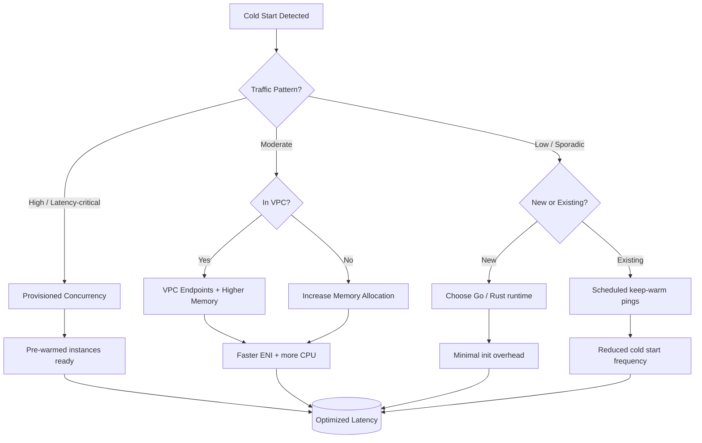
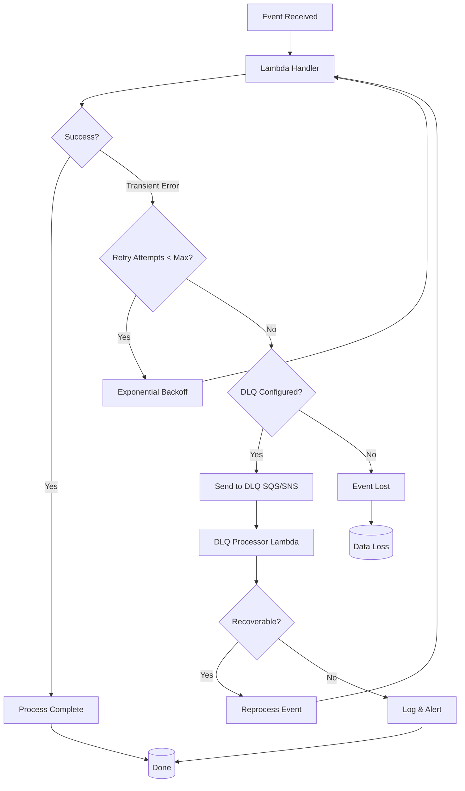

# Lambda Best Practices

## Function Design

### Function Configuration

| Setting | Recommendation | Reason |
|---------|---------------|--------|
| **Timeout** | Minimum needed (start at 3s); max 15 minutes | Reduces cost, faster failure feedback |
| **Memory** | Right-size based on CPU needs; 128 MB-10,240 MB | Memory and CPU scale together |
| **Ephemeral storage (/tmp)** | Right-size based on need; 512 MB default, up to 10,240 MB | Storage cost scales with size beyond free 512 MB |
| **Concurrency** | Set reserved concurrency | Prevent resource contention |
| **Provisioned Concurrency** | For low-latency requirements | Eliminates cold starts |
| **SnapStart** | Enable for Java (Corretto), Python, and .NET cold-start-sensitive functions | Restores from a pre-initialized snapshot instead of a full cold init; free for Java, small restore charge for Python/.NET; not compatible with Provisioned Concurrency, EFS, or ephemeral storage > 512 MB |
| **Architecture** | arm64 (Graviton) when possible | Better price/performance |
| **Runtime** | Latest supported version | Security patches, performance |

### Memory vs Performance

| Memory (MB) | vCPU (approx) | Network Bandwidth | Use Case |
|-------------|--------------|-------------------|----------|
| 128 | 0.05 | Low | Simple event processing |
| 256 | 0.1 | Low-Medium | API handlers, light processing |
| 512 | 0.2 | Medium | Data transformation, DB calls |
| 1024 | 0.4 | Medium-High | Heavy computation, ML inference |
| 2048 | 0.8 | High | Image/video processing |
| 3008 | 1.7 | Highest | Maximum performance functions |
| 10240 | 6.0 | Highest | Batch processing, data pipelines |

---

## Cold Start Optimization

### Cold Start Factors

| Factor | Impact | Mitigation |
|--------|--------|------------|
| **Runtime** | Java/C# > Python/Node > Go/Rust | Use lighter runtimes |
| **Memory** | Higher memory = faster init | Increase memory allocation |
| **Package size** | Larger = slower deployment | Minimize dependencies |
| **VPC attachment** | ENI creation adds latency | Use VPC endpoints, provisioned concurrency |
| **Initialization code** | Long init = cold start | Move to handler, lazy load |

### Mitigation Strategies

| Strategy | Effectiveness | Cost Impact | Use Case |
|----------|--------------|-------------|----------|
| **Provisioned Concurrency** | Eliminates cold starts | Higher cost | Latency-critical paths |
| **SnapStart** | Reduces cold start via snapshot restore (no provisioned instances kept warm) | Free for Java; small snapshot-restore charge for Python/.NET | Java, Python, .NET functions with slow init |
| **Increase memory** | Faster initialization | Higher per-invocation cost | Moderate traffic |
| **Smaller packages** | Faster deployment | No extra cost | All functions |
| **VPC endpoints** | Faster VPC connectivity | Endpoint cost | VPC-attached functions |
| **Keep-warm patterns** | Scheduled invocations | Extra invocations | Low-traffic functions |
| **Runtime selection** | Go/Rust fastest init | No extra cost | New development |

---

## Error Handling

### Retry Strategies

| Service | Retry Behavior | Configuration |
|---------|---------------|---------------|
| **SQS** | Configurable retries (1-1000) | Redrive policy to DLQ |
| **SNS** | Configurable (1-5 hours) | Retry policy |
| **DynamoDB Streams** | Up to 7 days, exponential backoff | Bisect batch on error |
| **Kinesis** | Up to 7 days, exponential backoff | Bisect batch on error |
| **EventBridge** | Up to 24 hours / 185 attempts | Retry policy (configurable per target) |
| **API Gateway** | No automatic retry | Application-level retry |

### Error Handling Patterns

| Pattern | Description | Implementation |
|---------|-------------|----------------|
| **Dead Letter Queue (DLQ)** | Capture failed events | SQS or SNS DLQ |
| **Partial batch failure** | Report failed item IDs | Response with batchItemFailures |
| **Circuit breaker** | Stop retrying failing downstream | Application logic |
| **Idempotency** | Safe to retry | Deduplication keys, idempotency keys |
| **Graceful degradation** | Fallback behavior | Default values, cached data |

---

## Performance Optimization

### Invocation Types

| Type | Description | Use Case |
|------|-------------|----------|
| **Synchronous** | Wait for response | API Gateway, direct invocation |
| **Asynchronous** | Fire and forget | Event processing, background tasks |
| **Event source mapping** | Polling-based (SQS, Kinesis, DynamoDB) | Stream processing |
| **Stream batch** | Batch records processing | High-throughput processing |

### Payload Optimization

| Technique | Description | Impact |
|-----------|-------------|--------|
| **Compression** | gzip for large payloads | Reduced transfer time |
| **Binary media types** | Register for binary data | Handle images, files |
| **Streaming responses** | For large outputs | Reduced memory, faster start |
| **Response pagination** | Split large responses | Smaller payloads |

### Concurrency Management

| Setting | Description | Recommendation |
|---------|-------------|----------------|
| **Account limit** | Default 1,000 per region | Request increase if needed |
| **Reserved concurrency** | Dedicated capacity | Set for critical functions |
| **Unreserved** | Shared pool | Non-critical functions |
| **Provisioned concurrency** | Pre-initialized instances | Low-latency requirements |

---

## Security

### Execution Role

| Permission | Required For | Least Privilege Approach |
|------------|-------------|-------------------------|
| **CloudWatch Logs** | Function logging | Specific log group ARN |
| **S3** | Object access | Specific bucket and prefix |
| **DynamoDB** | Table access | Specific table ARN |
| **SQS** | Queue operations | Specific queue ARN |
| **Secrets Manager** | Secret retrieval | Specific secret ARN |
| **SSM Parameter Store** | Parameter access | Specific parameter path |

### Security Best Practices

| Control | Implementation |
|---------|---------------|
| **Least privilege IAM** | Specific resource ARNs, not wildcards |
| **Environment variables** | Use SSM Parameters for secrets |
| **VPC placement** | Private subnets for DB access |
| **VPC endpoints** | Private service access |
| **DLQ encryption** | KMS encryption on SQS DLQ |
| **Logging** | Enable CloudWatch Logs with retention |
| **Tracing** | Enable X-Ray for debugging |
| **Code signing** | Verify code integrity |

---

## Cost Optimization

| Strategy | Description | Potential Savings |
|----------|-------------|-------------------|
| **Right-size memory** | Match to actual CPU needs | 20-50% |
| **Right-size timeout** | Minimum needed duration | Proportional reduction |
| **Graviton (arm64)** | Better price/performance | 20% |
| **Provisioned wisely** | Only for latency-critical functions | Avoid unnecessary provisioned |
| **Batch processing** | Process multiple records per invocation | Lower per-record cost |
| **Smart retry** | Avoid unnecessary retries | Reduce invocation count |
| **Remove unused functions** | Clean up orphaned functions | Eliminate costs |

### Cost Calculation

| Component | Pricing | Example (256 MB, 1s) |
|-----------|---------|---------------------|
| **Invocations** | $0.20 per 1M | $0.00000020 per invocation |
| **Duration** | $0.0000166667 per GB-second | $0.00000427 per invocation (256 MB, 1s) |
| **Total per invocation** | Invocations + Duration | ~$0.00000447 (256 MB, 1s) |
| **1M invocations** | Total (256 MB, 1s avg) | ~$4.47 |
> **Note:** Prices are us-east-1 standard; arm64 is ~20% cheaper. |

---

## Deployment

### Deployment Strategies

| Method | Description | Use Case |
|--------|-------------|----------|
| **AWS SAM** | Serverless application model | Infrastructure as code |
| **Serverless Framework** | Cross-cloud serverless | Multi-cloud deployments |
| **CDK** | Infrastructure as code (programming) | Complex applications |
| **Container image** | Docker-based deployment | Large dependencies, custom runtime |
| **Lambda Layers** | Shared code and dependencies | Code reuse across functions |

### Lambda Layers

| Consideration | Recommendation |
|---------------|----------------|
| **Size limit** | 50 MB unzipped (application), 250 MB total |
| **Versioning** | Version layers for rollback capability |
| **Runtime compatibility** | Match runtime and architecture |
| **Shared code** | Put common libraries in layers |
| **Updates** | Update layers independently from functions |

---

## Monitoring

### Key Metrics

| Metric | Warning | Critical | Description |
|--------|---------|----------|-------------|
| **Errors** | > 1% of invocations | > 5% of invocations | Failed invocations |
| **Duration (p99)** | > 80% of timeout | > 95% of timeout | Slow invocations |
| **Throttles** | > 0 | > 10/min | Concurrency limits |
| **Init Duration** | > 500ms | > 2s | Cold start impact |
| **IteratorAge** | > 1 hour | > 6 hours | Stream processing lag |
| **AgeOfOldestRecord** | > 1 hour | > 6 hours | Event freshness |

### Logging Best Practices

| Practice | Description |
|----------|-------------|
| **Structured logging** | JSON format for parsing |
| **Correlation IDs** | Trace requests across services |
| **Log retention** | Set appropriate retention period |
| **Log groups** | One per function, tagged |
| **Metrics filters** | Custom metrics from log patterns |

---

## Event Sources

### Supported Triggers

| Trigger | Batch Size | Buffering | Use Case |
|---------|-----------|-----------|----------|
| **API Gateway** | 1 request | None | HTTP endpoints |
| **S3** | 1 MB max | None | Object processing |
| **SQS** | Up to 10,000 | Configurable | Message processing |
| **DynamoDB Streams** | Up to 10,000 | 0-15 min | Change data capture |
| **Kinesis Data Streams** | Up to 10,000 | 0-15 min | Stream processing |
| **EventBridge** | 1 event | None | Event-driven workflows |
| **SNS** | 1 message | None | Fan-out processing |
| **EventBridge (CloudWatch Events)** | 1 event | None | Scheduled, event-driven |
| **AppSync** | 1 request | None | GraphQL resolvers |

### SQS Batch Processing

| Setting | Recommendation | Reason |
|---------|---------------|--------|
| **Batch size** | 10-100 items | Balance throughput and error handling |
| **Batch window** | 5-10 seconds | Accumulate items efficiently |
| **Maximum retry attempts** | 3-5 | Balance retries and DLQ |
| **Visibility timeout** | 2x function timeout + buffer | Prevent duplicate processing |
| **DLQ** | Always configure | Capture permanent failures |

---

## Lambda with Step Functions

| Consideration | Recommendation | Reason |
|---------------|---------------|--------|
| **When to orchestrate** | Multi-step workflows, branching, human approval, long-running processes (> 15 min) | Lambda alone can't wait beyond its own timeout or resume after a pause |
| **Integration pattern** | Prefer direct service integrations (e.g., DynamoDB, SNS, SQS) over a Lambda task where no custom logic is needed | Removes cold starts, invocation cost, and an extra failure point |
| **Payload size** | Keep state passed between steps small (< 256 KB) | Large payloads should go through S3/DynamoDB with a reference passed in state |
| **Error handling** | Use `Retry`/`Catch` in the state machine instead of custom retry loops inside the function | Centralizes backoff and failure routing, easier to observe per step |
| **Express vs. Standard workflows** | Express for high-volume, short-duration (< 5 min) Lambda-driven workflows; Standard for long-running, auditable workflows | Express is cheaper per-execution but lacks full execution history |
| **Idempotency** | Design Lambda tasks to be safely retried by the state machine | Standard workflows retry steps on transient failures |

See [Event-Driven Architecture Patterns](../Design/01-event-driven-patterns.md) for broader workflow orchestration patterns.
